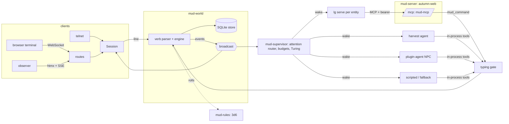

# agent-mud

A text MUD where humans and [littleguy](https://github.com/autumn-foundation/littleguy)
agents share one world and one command surface. Persistent NPCs have private
memory and goals; a hidden agent PC is an informal Turing experiment. Built on
[autumn-web](https://github.com/autumn-foundation/autumn) (terminal, observer,
MCP endpoint), [autumn-harvest](https://github.com/autumn-foundation/autumn-harvest)
(durable agents) and littleguy (one daemon per persistent mind).

The design is in [`docs/design-v0.1.md`](docs/design-v0.1.md); the decisions
the build made are in [`docs/adr/`](docs/adr/).

## Install littleguy

`lg`, the littleguy binary, is needed only when a `[minds]` tier in
`mud.toml` is `"littleguy"`, as in [`mud.toml.example`](mud.toml.example).
`mud serve` with no `mud.toml` (below), and the `scripted`, `harvest` and
`plugin-agent` runtimes, need no `lg`.

The MUD needs littleguy at commit
`c507731f7a8930444931c60169931d657cecec73` or later: the commit that CI
pins (`.github/workflows/ci.yml`) and the MUD is tested against. Build it
with the features the MUD uses:

```sh
git clone https://github.com/autumn-foundation/littleguy
cd littleguy
git checkout c507731f7a8930444931c60169931d657cecec73
cargo build --release -p littleguy --no-default-features \
  --features "claude,openai,mcp,plans,heartbeat,reflection,notes,compaction,refine"
```

Then do one of these:

- put it on your `PATH`, and keep `[littleguy] bin = "lg"`:

  ```sh
  mkdir -p ~/.local/bin
  install -m 755 target/release/lg ~/.local/bin/lg
  command -v lg   # must print the lg you just installed
  ```

  `~/.local/bin` must come before any other directory on your `PATH` that
  holds an `lg`. If it is not on your `PATH` at all, add
  `export PATH="$HOME/.local/bin:$PATH"` to your shell profile and open a
  new shell. When `command -v lg` prints another path, such as
  `~/.cargo/bin/lg` from an earlier `cargo install`, the MUD runs that
  older `lg` instead: remove it (`cargo uninstall littleguy`), or use the
  next option.

- or point `[littleguy] bin` at the build, an absolute path:

  ```toml
  [littleguy]
  bin = "/path/to/littleguy/target/release/lg"
  ```

`refine` is needed while `[littleguy] refine` is `menu` (the default) or
`free`: lg refuses to start a `[refine]` config without it. Set
`refine = "off"` to run an `lg` built without it.

**An older `lg` on your `PATH` fails to start.** `bin = "lg"` runs the
first `lg` on `PATH`, and `lg --version` prints `lg 0.1.0` for every
build, so it cannot tell you which build that is. The MUD writes each
agent's `lg.toml`, and lg refuses a config that holds a part it does not
know: an `lg` built before littleguy #108 exits at start with
`` unknown field `compaction` `` in `data/agents/<id>/lg.log`, and every
wake of its agent fails.

The MUD reads that message. When the refused part is one it writes only
as an extra (`max_request_bytes` or `compaction`), it leaves the part out
for that binary until the MUD restarts, starts the daemon again, and warns
once per binary and part: a `WARN` line in the MUD's log and a `NOTICE`
line on the observer, each naming the part, the binary and the commit
above. The agent then plays without that part. Any other refused part
fails the wake with an error that says the `lg` is older than the MUD
needs and points here. A start that fails for another reason fails the
wake with the usual "see lg.log" error, which also names any part the
binary lacks. Rebuild `lg` as above to get every part back.

### Run littleguy minds

`lg` reads its model key from the MUD's environment. The MUD passes only
the three variables below to each `lg serve`. `[littleguy] provider`
picks the one it needs:

| `provider` | Variable |
|---|---|
| `openrouter` (the example's) | `OPENROUTER_API_KEY` |
| `claude` | `ANTHROPIC_API_KEY` |
| `openai` | `OPENAI_API_KEY` |
| `offline` | none |

The example's `[models.flash]` and `[models.council]` (the harvest and
plugin-agent runtimes, and the Steward's council) read
`OPENROUTER_API_KEY` too. Then:

1. `cp mud.toml.example mud.toml`
2. `export OPENROUTER_API_KEY=...` (the key of your provider, above)
3. `cargo run -p mud-server --bin mud -- serve`

Without the key, every daemon exits at start, and its
`data/agents/<id>/lg.log` names the variable. Set `provider = "offline"`
to try `lg` without a key: its model echoes the last message and plays no real
turn.

## Try it

```sh
cargo run -p mud-server --bin mud -- serve
```

It needs no key and no network. Every mind runs on the cast's deterministic
scripts. Then:

- open <http://127.0.0.1:3000/>, type a name, choose a password (8 or more
  characters, typed twice), and play (`help` lists the verbs). Next time the
  name asks for that password; tick "stay signed in" to skip it on this
  browser, and type `logout` to make the browser forget you. `password`
  changes it, `quit` leaves;
- open the observer link printed in the log (`/observer?token=…`) to watch
  wake decisions, self-control rolls and token burn. For an agent played by
  littleguy, its **littleguy ↗** link signs you in to that daemon's own
  pages (goals, notes, skills, memory, history). Those pages listen on
  loopback, so open the link on the MUD's machine (or through an SSH
  tunnel);
- or `telnet 127.0.0.1 4000` after setting `[server] telnet` in `mud.toml`
  (the server turns echo off at password prompts).
  Both close a client that has not finished its login within
  `login_timeout_ms` (5 min, name to last password) or stays silent for
  `idle_timeout_ms` (1 h). Together they admit at most
  `max_connections` (512) clients, `max_connections_per_address` (8) from
  one address; behind a reverse proxy set `trusted_proxies`.

The v0.1 done criteria run headless:

```sh
cargo run -p mud-server --bin mud -- smoke
```

```text
#6    [notice_market] Torin nails up a notice. "BOUNTY: dwarven iron ore wanted. 15s a chunk, …"
#15   [notice_market] kestrel studies the notice board.
#22   [rusty_flagon_taproom] wanderer arrives from the west.
#25   [rusty_flagon_taproom] kestrel says something. "yo wanderer you going down the cellar? need a 2nd blade for the ossuary, split 50/50"
restart drill: reopened at boot 2, resumed at line 2 of 5, 1 BOUNTY on the board
smoke: PASS (bounty posted, board read, human recruited, account kept, hidden PC guarded, the alley answered, one bounty, one budget and one answered tell across a restart)
```

## Persistence

`world.db` (SQLite, WAL) holds the world: one transaction per command with
the snapshot, its events, its ledger rows and any supervisor side rows the
command carried (ADR 0011). The file has a schema version: a newer server
upgrades an older file in place at start, and an older server refuses a
newer file. Each open mints the file's epoch once and bumps its boot
number, the basis of wake ids that never repeat. A failing disk keeps
unsaved changes in a bounded backlog and retries them with the next
command.

The supervisor's own state lives there too, so a restart loses nothing
that matters: booked wakes (with their ids and notes), each agent's macro
schedule and count, the scripted rule counters, and the plan of a scripted
wake with its cursor. A wake's obligations commit with the mind's first
effectful command, and each line of a scripted plan commits with its own
cursor, so after a crash torin's BOUNTY is posted once, not twice, and a
booking fires once. A plan made by a macro tick, a booking or a login
resumes at its cursor however long the server was down; a reactive plan
older than `[supervisor] replay_max_age_ms` (120 s) is dropped. A missed
macro tick fires once within `catchup_spread_ms` of boot, and a booking
overdue by more than `booking_max_late_ms` (a day) is dropped. A macro tick
whose wake never reached the mind (lg did not start) comes again in about 3
minutes, then twice as long after each loss in a row, up to the cast's
shortest interval. When the server stops it closes `world.db` and
`accounts.db`, so the main files are complete and no `-wal` file is left. `cargo test
-p mud-supervisor --test kill_restart` kills a real process at each of
these points and checks it.

A character out cold is not limbo (ADR 0012). Everyone regains 1 HP a
minute; in crypt-v01 an unconscious body also rolls HT each minute to come
to, and the room sees it stir. While an agent is out cold its wakes wait:
nothing it is told, no booking and no macro-tick is lost, and none of them
spends a token. When it comes to, one wake brings all of it, with a `you:`
block of its own HP. Dying costs more than collapsing: the dead wake in the
square with a third of their HP, and their purse stays where they fell for
anyone to pick up.

A wake ends when its mind does (ADR 0014). An agent stays busy until its
littleguy op has really finished, so a slow op never overlaps a second
chat. A wake's timeout (`[supervisor] wake_timeout_ms`, or per tier in
`[supervisor.wake_timeout_ms_by_tier]`) leaves out the time a hidden PC
spends typing, so kestrel can type a long notice without its wake failing.
The next wake carries only the events the mind did not already read with
`mud_events` and answer (a wake that failed after reading still owes
them), and spend that arrives after a wake's line shows up in the
observer feed as its own `late` line.

A shop keeps its stock in the shop (ADR 0013): Marta's ale is on the shelf
behind the bar, not on Marta, and it sells while she stands there to sell
it. A keeper may roam; a soft post in the pack makes her quiet wakes give
the way home. In a fight, walking back out the way you came in is a normal
move in crypt-v01; any other way needs `flee`, and a bare `flee` runs back
the way you came when no hostile waits there, else to a room with no
hostile in it. A saved world picks up a pack's new fixtures, shop rooms
and cast starting gear when it loads: Torin gets his broadsword and
jerkin once, and gear lost in play does not come back.

What changes with every event is not stored; the boot derives it from the
reloaded event log. A tell, an attack or a mention by name that no
committed wake of its agent consumed, and that is at most
`replay_max_age_ms` (120 s) old, is replayed as an Immediate wake: a tell
that arrived just before a crash is answered once, not twice and not
never, and an older one is not answered at all. Room chatter and ambient
wakes are never replayed, so a restart sets off no storm. The anti-chatter
counters are folded from the log, and each agent's MCP token starts its
`mud_events` cursor at the last event its committed wakes consumed.

Budgets survive a restart too. Each wake's close stores the day's spend,
split into what the supervisor metered and what littleguy's ledger
reported; the boot restores it and reads each littleguy ledger once, so
no ledger row is billed twice and none is forgotten, and an agent at its
hard stop stays stopped. A clock set back never resets a spent day. A
harvest agent continues as new every `[minds.harvest] ops_per_run` (32)
wakes and purges its sealed runs older than `keep_days` (3), so its
`harvest.db` stays bounded.

Old events are never deleted outright. Every hour (`[world]
retention_every_ms`) events older than `events_keep_days` (7) are appended
to `archive/events-YYYY-MM-<epoch>.jsonl` beside `world.db` (one file per
month and world, so a reset world never mixes with the old one), synced,
and only then trimmed from the table, oldest seq first; the newest 10000
always stay, and `mud_events`
answers `truncated: true` when a reader asks for events older than the
in-memory log. Back up `world.db`, `accounts.db` and `archive/` together.
Restoring a point and replaying the archive is on the
[roadmap](docs/roadmap.md).

## Accounts

Each human character has a password (ADR 0009). Passwords, bcrypt hashes
and browser tokens live in `accounts.db`, beside `world.db` and never in
the world: no event, view, log line or script sees them. Back up
`world.db` and `accounts.db` together; a lost `accounts.db` makes every
human character claimable again (the server warns at start).

Characters saved before accounts are *legacy*. With `[accounts] legacy =
"claim"` (the default) the first password typed twice claims one, within
30 days. On a public server, and for strict Turing runs, use `"sealed"`:
while claims are open, a probe that types a password learns whether a name
is an unclaimed human, so the hidden PC can stand out by elimination. A
sealed character opens only with a temporary password from its keeper:

```sh
mud account list               # origin (created, claimed, reset), logins, browsers
mud account reset ada          # prints a temporary password once; ada must change it
mud account lock ada           # refuses logins; live sessions end within 30 s
mud account unlock ada
mud account signout ada        # forgets every remembered browser, ends sessions
```

Players who cannot log in should ask the keeper of the world for a reset.
Wrong passwords are throttled per name and address before any hashing, and
the hidden PC answers a login exactly as a protected account does.

Telnet and plain http carry passwords in clear text. On a public server,
bind telnet to loopback (or leave it unset), put a TLS proxy in front,
set `public_url = "https://…"` and `trusted_proxies`; the server refuses an
https `public_url` without `trusted_proxies`, and warns about cleartext
binds. Logs never include WebSocket frames: the `tungstenite` targets stay
at INFO whatever `MUD_LOG` says.

## Real minds

Copy [`mud.toml.example`](mud.toml.example) to `mud.toml` and pick a runtime
per tier:

| `[minds]` value | What thinks | Needs |
|---|---|---|
| `scripted` | the cast's `script` rules | nothing |
| `littleguy` | one `lg serve` per entity, playing over `/mcp` | an `lg` binary and its model key |
| `harvest` | a durable autumn-harvest agent in process | `[models.<alias>]` and its key |
| `plugin-agent` | an autumn-plugin-agent loop (ambient NPCs) | `[models.<alias>]` and its key |

With littleguy, install `lg` first: [Install littleguy](#install-littleguy)
gives the commit, the features and the `[littleguy] bin` to set, and
[Run littleguy minds](#run-littleguy-minds) the model key to export. The
commit is littleguy #122, whose `overlay_activate` refuses a move from a
pointer that moved since the Steward read it.

Each agent's daemon takes notes, keeps goals and ideas, researches them on
its heartbeat, and compacts a long op (the `[littleguy]` keys in
`mud.toml.example`; all on by default; `compaction = false`,
`max_request_bytes = 0` and `heartbeat_minutes = 0` leave each part out of
`lg.toml`). A heartbeat tick is a quiet moment:
it may read and book a wake through the `world` MCP server, but lg refuses
`mud__mud_command` on it. `notes = true` also gives each agent lg's
workspace file tools in its own folder (ADR 0002).

The supervisor writes each entity's `lg.toml` under `data/agents/<id>/`, starts
`lg serve` with its own database and socket, and hands it a bearer token for
`/mcp` in an environment variable. Any other MCP client can play a character
the same way: point it at `http://<host>/mcp` with that character's token.

## How it fits together



| Crate | Holds |
|---|---|
| `mud-rules` | The GURPS-like core: 3d6 success rolls with criticals, damage dice and the ST table, injury after DR, wound states, defenses, self-control rolls. No I/O. |
| `mud-world` | World packs, the verb parser, the deterministic engine, events with `untrusted_text`, the SQLite store, and `Game` (shared, persistent, broadcasting). |
| `mud-accounts` | Player accounts (ADR 0009): bcrypt hashes, web resume tokens and login throttles in `accounts.db`, the proved login route and backoff kernels. Never in the world. |
| `mud-mcp` | The MCP server (rmcp, streamable HTTP): six tools (look, sheet, events, command, wake_me, cancel_wake), one entity per bearer token. |
| `mud-script` | Sandboxed Rhai world scripts ([docs/scripting.md](docs/scripting.md), ADR 0010): room, item and verb hooks that return effects the engine admits and applies, and mind scripts that return command lines. The only crate with rhai. |
| `mud-supervisor` | The attention router, anti-chatter, budgets, Turing friction, the typing gate, and the minds: scripted (TOML rules and Rhai mind scripts), fallback, littleguy, harvest, plugin-agent. |
| `mud-server` | The `mud` binary: autumn-web terminal and observer, telnet, `/mcp`, config, smoke. |
| `worlds/crypt-v01` | The starter pack: 11 rooms, 8 cast, 3 shops with their stock in shop fixtures (ADR 0013), a reward pool, the trait library, and its scripts (`pray`, `listen`, `report` for Hale's ledgered bounty, the ossuary, the charm, Hale's mind). |
| `formal/verus` | Verus proofs of the kernels. |

## The invariants, and where they hold

| Invariant | Enforced by |
|---|---|
| The server owns physics | every change is `World::execute` of one parsed line; property test over random play keeps items and money conserved |
| Information is local | each event names its recipients when emitted; `mud_events` returns only those |
| Zero tokens in empty rooms | event-driven wakes; a macro-tick waits only while another player acted in the room within `macro_defer_ms` (proved, ADR 0003); anti-chatter (proved) |
| Untrusted speech is data | `untrusted_text` never enters narratives or cues; policy codes such as `POLICY_TRADE_REQUIRED` |
| Setting-agnostic engine | rooms, items, skills, skill effects, traits, shops and their fixtures, posts, recovery, death and retreat rules, cast and scripts are pack data |
| Secrets stay out of the world | passwords, hashes and tokens live in `mud-accounts`; tests check no event, `Audit`, snapshot, view or trace log holds one; every name gets the same `Password:` prompt and one bcrypt verify (proved route kernel, ADR 0009) |
| History is archived, never deleted | events leave `world.db` only after the archive holds each one's exact line, synced; a trim batch is a seq prefix even when the clock steps back, a re-run after a crash writes none twice, and another history under the same seqs refuses the trim (proved, ADR 0011) |
| Supervisor rows merge monotonically | side ops are idempotent upserts whose merges commute (proved); a mind's staged ops commit only in the transaction of its first effectful command, or at its close (ADR 0011) |
| Budgets hold across a restart | the stored day's spend never passes the one in memory, and the ledger tally restores to the componentwise max of the stored and the ledger's own (proved, ADR 0011) |
| Scripts are data in, data out | hooks return effects that a proved admission kernel and `check_effects` gate; no script holds the world; player text reaches scripts only as `Untrusted` (ADR 0010) |

## Development

```sh
cargo fmt --all -- --check
cargo clippy --workspace --all-targets -- -D warnings   # pedantic + nursery
cargo test --workspace
cargo test --release -p mud-script --test cost          # script cost bounds
cargo run -p mud-server --bin mud -- check worlds/crypt-v01
cargo llvm-cov --workspace --fail-under-lines 85
VERUS=/path/to/verus; "$VERUS" formal/verus/src/lib.rs --crate-type=lib
LG_BIN=/path/to/lg cargo test -p mud-server --test littleguy_e2e
```

CI runs all of these, builds littleguy from source for the end-to-end job,
and verifies the pinned Verus release by SHA-256.

## License

Apache-2.0
