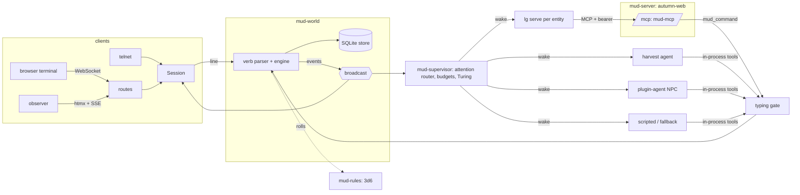

# agent-mud

A text MUD where humans and [littleguy](https://github.com/autumn-foundation/littleguy)
agents share one world and one command surface. Persistent NPCs have private
memory and goals; a hidden agent PC is an informal Turing experiment. Built on
[autumn-web](https://github.com/autumn-foundation/autumn) (terminal, observer,
MCP endpoint), [autumn-harvest](https://github.com/autumn-foundation/autumn-harvest)
(durable agents) and littleguy (one daemon per persistent mind).

The design is in [`docs/design-v0.1.md`](docs/design-v0.1.md); the decisions
the build made are in [`docs/adr/`](docs/adr/).

## Try it

```sh
cargo run -p mud-server --bin mud -- serve
```

It needs no key and no network. Every mind runs on the cast's deterministic
scripts. Then:

- open <http://127.0.0.1:3000/>, type a name, and play (`help` lists the verbs);
- open the observer link printed in the log (`/observer?token=…`) to watch
  wake decisions, self-control rolls and token burn;
- or `telnet 127.0.0.1 4000` after setting `[server] telnet` in `mud.toml`.
  Both close a client that gives no name within `login_timeout_ms` (60 s)
  or stays silent for `idle_timeout_ms` (1 h). Together they admit at most
  `max_connections` (512) clients, `max_connections_per_address` (8) from
  one address; behind a reverse proxy set `trusted_proxies`.

The v0.1 done criteria run headless:

```sh
cargo run -p mud-server --bin mud -- smoke
```

```text
#6    [notice_market] Torin nails up a notice. "BOUNTY: dwarven iron ore wanted. 15s a chunk, …"
#15   [notice_market] kestrel studies the notice board.
#22   [rusty_flagon_taproom] wanderer arrives from the west.
#25   [rusty_flagon_taproom] kestrel says something. "yo wanderer you going down the cellar? need a 2nd blade for the ossuary, split 50/50"
smoke: PASS (bounty posted, board read, human recruited)
```

## Real minds

Copy [`mud.toml.example`](mud.toml.example) to `mud.toml` and pick a runtime
per tier:

| `[minds]` value | What thinks | Needs |
|---|---|---|
| `scripted` | the cast's `script` rules | nothing |
| `littleguy` | one `lg serve` per entity, playing over `/mcp` | an `lg` binary and its model key |
| `harvest` | a durable autumn-harvest agent in process | `[models.<alias>]` and its key |
| `plugin-agent` | an autumn-plugin-agent loop (ambient NPCs) | `[models.<alias>]` and its key |

With littleguy, build `lg` from the littleguy repository and point
`[littleguy] bin` at it:

```sh
cargo build --release -p littleguy --no-default-features \
  --features "claude,openai,mcp,plans,heartbeat,reflection,notes,compaction"
```

The supervisor writes each entity's `lg.toml` under `data/agents/<id>/`, starts
`lg serve` with its own database and socket, and hands it a bearer token for
`/mcp` in an environment variable. Any other MCP client can play a character
the same way: point it at `http://<host>/mcp` with that character's token.

## How it fits together



| Crate | Holds |
|---|---|
| `mud-rules` | The GURPS-like core: 3d6 success rolls with criticals, damage dice and the ST table, injury after DR, wound states, defenses, self-control rolls. No I/O. |
| `mud-world` | World packs, the verb parser, the deterministic engine, events with `untrusted_text`, the SQLite store, and `Game` (shared, persistent, broadcasting). |
| `mud-mcp` | The MCP server (rmcp, streamable HTTP): four tools, one entity per bearer token. |
| `mud-supervisor` | The attention router, anti-chatter, budgets, Turing friction, the typing gate, and the minds: scripted, fallback, littleguy, harvest, plugin-agent. |
| `mud-server` | The `mud` binary: autumn-web terminal and observer, telnet, `/mcp`, config, smoke. |
| `worlds/crypt-v01` | The starter pack: 11 rooms, 8 cast, 3 shops, the trait library. |
| `formal/verus` | Verus proofs of the kernels. |

## The invariants, and where they hold

| Invariant | Enforced by |
|---|---|
| The server owns physics | every change is `World::execute` of one parsed line; property test over random play keeps items and money conserved |
| Information is local | each event names its recipients when emitted; `mud_events` returns only those |
| Zero tokens in empty rooms | event-driven wakes; macro-ticks only with no human present; anti-chatter (proved) |
| Untrusted speech is data | `untrusted_text` never enters narratives or cues; policy codes such as `POLICY_TRADE_REQUIRED` |
| Setting-agnostic engine | rooms, items, skills, skill effects, traits, shops and cast are pack data |

## Development

```sh
cargo fmt --all -- --check
cargo clippy --workspace --all-targets -- -D warnings   # pedantic + nursery
cargo test --workspace
cargo llvm-cov --workspace --fail-under-lines 85
VERUS=/path/to/verus; "$VERUS" formal/verus/src/lib.rs --crate-type=lib
LG_BIN=/path/to/lg cargo test -p mud-server --test littleguy_e2e
```

CI runs all of these, builds littleguy from source for the end-to-end job,
and verifies the pinned Verus release by SHA-256.

## License

Apache-2.0
