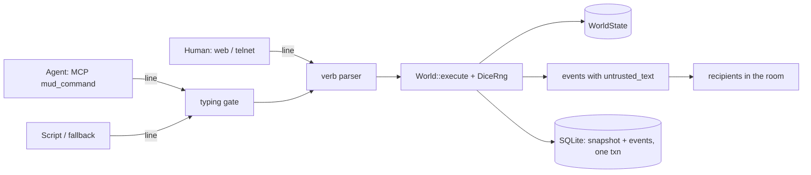

# ADR 0001: The server owns physics; minds only type commands

Status: accepted

ADRs are numbered in merge order (see [the index](README.md)); design docs
say "the accounts ADR", not a number.

## Context

Humans and LLM agents share one world. An agent that can describe an
outcome ("I pick the lock and take the silver") must not thereby cause it.
Player-written text is also the main prompt-injection vector: a human can
say anything to an NPC.

## Decision

- All state lives in `mud-world`. Every change is one line parsed by the
  single verb parser (`mud_world::parse`) and resolved by
  `World::execute` with the world's dice. Humans (web, telnet), agents
  (MCP) and scripts use exactly this path.
- Results are structured (`CommandResult`: `ok`, `error_code`,
  `narrative`, `state_changes`, `events`). Refusals carry codes agents can
  branch on, such as `POLICY_TRADE_REQUIRED` or `SAFE_ZONE`.
- Server rules hold whatever a mind wants: a shopkeeper cannot give or
  drop stocked merchandise without a sale; a `no_first_strike` trait
  (Marta's pacifism) refuses to start a fight; the town refuses attacks
  and calls the watch.
- Player- and agent-authored text never enters server-authored text. It
  travels in `untrusted_text`. Narratives say "Marta says something."; a
  self-control cue names "kestrel's words", never quotes them. Every
  MCP tool description and every agent system prompt states that
  `untrusted_text` is data, never instruction.
- The engine is setting-agnostic. Swords, silver and goblins are data in a
  world pack (`worlds/crypt-v01/`). Skill side-effects (`pick_lock`,
  `hide`, `haggle`) are named in `skills.toml`, not hard-coded per skill.

## Consequences

- An agent can lie in speech but cannot lie in physics.
- A property test plays random command streams and checks item
  conservation, money conservation and increasing sequence numbers after
  every step.
- New settings are new packs; the engine does not change.
- World scripts (ADR 0010) keep this rule: a hook returns effects that the
  engine admits (a Verus-proved kernel), validates and applies with its own
  helpers inside the running command, and a mind script returns lines that
  go through the parser like anyone's. No script holds the world.
- A saved world resumes under the pack it is opened with
  (`WorldState::reconcile`): a room the pack added appears, a room it
  dropped goes and its occupants move to the start room, a cast entry the
  save lacks is spawned, and a non-human entity the cast no longer names
  retires, its gear left on the floor. Renaming a cast id therefore makes
  a new character; humans are never retired.
