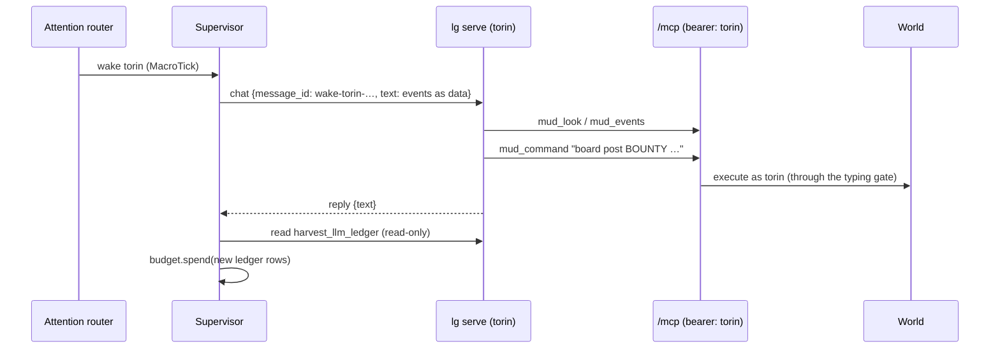

# ADR 0002: The supervisor owns lifecycle; littleguy owns minds

Status: accepted

## Context

Persistent NPCs run on littleguy, an always-on agent daemon built on
autumn-harvest (one SQLite file per agent, durable memory, goals and
notes). littleguy refuses non-internal MCP tool calls on unattended
heartbeat ticks, so a heartbeat cannot drive an NPC to act in the world.

## Decision

Mirror the harvest-camel boundary: the MUD owns the world and every
process lifecycle; littleguy owns the mind.

- For each persistent entity, `mud-supervisor` writes an `lg.toml`
  (persona, goal, tools off except plans, `[ui] bind = 127.0.0.1:0`, a
  reflection heartbeat with research off, and one `[[mcp.server]]` named
  `mud` labelled `untrusted_input` with effect `write`), then starts
  `lg serve --db <dir>/lg.db --socket <dir>/lg.sock`.
- The MCP bearer token is minted per entity by `mud-mcp`'s
  `TokenRegistry` and passed only in the `MUD_MCP_TOKEN` variable, never
  in a file. The child gets a cleared environment: `PATH`, `HOME`, model
  keys, and its own `XDG_*` folders.
- Each wake is a `chat` request on the daemon's socket (an attended op,
  so MCP tools are allowed). The wake id is the message id, so a retried
  wake runs once.
- Spend is read from the daemon's own cost ledger, not from the reply.
  autumn-harvest writes every model call to `harvest_llm_ledger` in
  `lg.db`; `mud_supervisor::ledger::LedgerMeter` reads it through a
  read-only handle and charges each row once, to the reply while the wake
  waits and to the usage sink otherwise. So an op that ends with no answer
  ("I used every tool round…"), waits for an approval, outlives its wake,
  or a heartbeat between wakes, is charged too. A reply's own `usage` is
  used only when the daemon has no database to read. `[littleguy]
  max_steps` (64; `0` for no bound) bounds the tool rounds of one wake.
  Prompt caching makes a long wake cheap; the daily budget is the guard.
- littleguy's own heartbeat is kept for quiet reflection and memory
  consolidation only.
- **Its pages.** Each daemon serves littleguy's pages on a loopback port
  that the MUD picks free at start (`[ui] bind`; not port 0, because
  littleguy builds its sign-in link from that address). The observer's
  `/observer/agents/{id}/littleguy` asks the daemon for a one-time sign-in
  link (`{"kind":"ui_link"}`) and redirects there, never to a link off
  loopback.
- **Shutdown.** Each daemon holds an MCP session open (an SSE response),
  and a graceful HTTP shutdown waits for every open response. So the MUD
  stops its minds when shutdown *begins*, not after it drains: autumn's
  shutdown token cancels `Mud::shutdown`, which ends every MCP session
  (rmcp's `cancellation_token`) and the observer feed, aborts the
  supervisor's tasks, and kills and reaps every `lg serve`. After that no
  daemon starts (`LittleguyMind` is closed). Each daemon's process id is
  kept in `<dir>/lg.pid`; a daemon left by a run that crashed or was
  killed is stopped before its replacement starts, if its command line
  names that entity's socket.

## Amended by ADR 0011: lock order and open order

- **Lock order.** `world → (router | state | wakebook, one at a time) →
  store cell`. The store cell inside `Game` (the store, the open turns and
  the backlog of a failed save) is the last leaf. `Game::open_turn`,
  `Game::stage`, `Game::persist` and `Game::retain` take only the cell;
  `Game::act` and `Game::close_turn` take the world first, so the
  supervisor never calls them while it holds `router`, `state` or the wake
  book. The wake book's own writer lock, which serializes a book or a
  cancel around its durable write, comes before the world: it is taken
  only from a tool call or a mind's decision, never inside a world
  closure, and the book's bookings lock is released before `Game::act`
  runs. A debug build checks the rule: every supervisor lock is counted
  per thread, and the count must be zero before a booking's `Game::act`
  and before `Game::close_turn`.
- **Open order.** `Game::open` migrates `world.db`, mints its epoch once,
  bumps its boot number (one `synchronous = FULL` transaction), reloads the
  whole in-memory event log, and drops side rows of entities the pack no
  longer has. A `world.db` newer than the server is refused and the server
  does not start. Then the supervisor takes the side rows with
  `Game::take_restored()` and opens over them (`Supervisor::open`, phase
  2): bookings, the macro schedule and counters, rule counters and plans
  to resume, and (phase 3) each day's spend. Inside `Supervisor::open`,
  before any wake, every mind is asked to `prime`: a littleguy mind reads
  its daemon's ledger once and marks every row seen, and the ledger tally
  rises to what the ledger holds of today; a harvest mind gets back the
  token count it was charged up to. Wake ids are `wake-{epoch:016x}-{boot}-{entity}-{n}`, so a
  wake is never redelivered under an id littleguy has seen.
- **Settle before close.** A wake's turn closes, and its entity is free
  for the next wake, only when the mind has really finished
  (`Mind::settled`): a littleguy op is read and charged or its grace ran
  out, a harvest job is done. `WakeFinished` still goes to the observer at
  the timeout.

## Alternatives

- **In-process harvest agent** (`HarvestMind`): the same durable agent
  loop on autumn-harvest-agent's SQLite runtime, with the MUD tools as
  in-process `FnTool`s. It needs no `lg` binary and is what CI exercises
  with a scripted model. Pick it with `[minds] persistent = "harvest"`.
- **Ambient NPCs** (`AmbientMind`) use autumn-plugin-agent: a bounded
  agent loop with an in-memory rolling transcript. They are scenery.

## Consequences

- Any MCP-capable client can take over a character by holding its token.
- A CI job builds littleguy from source and runs a real `lg serve`
  against the server; it must list `mud__mud_command` and answer a wake.
