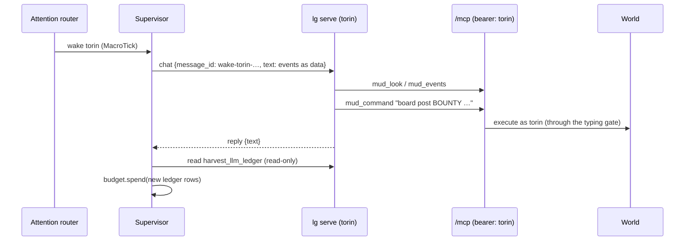

# ADR 0002: The supervisor owns lifecycle; littleguy owns minds

Status: accepted

## Context

Persistent NPCs run on littleguy, an always-on agent daemon built on
autumn-harvest (one SQLite file per agent, durable memory, goals and
notes). littleguy refuses non-internal MCP tool calls on unattended
heartbeat ticks, so a heartbeat cannot drive an NPC to act in the world.

## Decision

Mirror the harvest-camel boundary: the MUD owns the world and every
process lifecycle; littleguy owns the mind.

- For each persistent entity, `mud-supervisor` writes an `lg.toml`
  (persona, goal, tools off except plans, `[ui] bind = 127.0.0.1:0`, a
  reflection heartbeat with research off, and one `[[mcp.server]]` named
  `mud` labelled `untrusted_input` with effect `write`), then starts
  `lg serve --db <dir>/lg.db --socket <dir>/lg.sock`.
- The MCP bearer token is minted per entity by `mud-mcp`'s
  `TokenRegistry` and passed only in the `MUD_MCP_TOKEN` variable, never
  in a file. The child gets a cleared environment: `PATH`, `HOME`, model
  keys, and its own `XDG_*` folders.
- Each wake is a `chat` request on the daemon's socket (an attended op,
  so MCP tools are allowed). The wake id is the message id, so a retried
  wake runs once.
- Spend is read from the daemon's own cost ledger, not from the reply.
  autumn-harvest writes every model call to `harvest_llm_ledger` in
  `lg.db`; `mud_supervisor::ledger::LedgerMeter` reads it through a
  read-only handle and charges each row once, to the reply while the wake
  waits and to the usage sink otherwise. So an op that ends with no answer
  ("I used every tool round…"), waits for an approval, outlives its wake,
  or a heartbeat between wakes, is charged too. A reply's own `usage` is
  used only when the daemon has no database to read. `[littleguy]
  max_steps` (24) bounds the tool rounds of one wake.
- littleguy's own heartbeat is kept for quiet reflection and memory
  consolidation only.

## Alternatives

- **In-process harvest agent** (`HarvestMind`): the same durable agent
  loop on autumn-harvest-agent's SQLite runtime, with the four tools as
  in-process `FnTool`s. It needs no `lg` binary and is what CI exercises
  with a scripted model. Pick it with `[minds] persistent = "harvest"`.
- **Ambient NPCs** (`AmbientMind`) use autumn-plugin-agent: a bounded
  agent loop with an in-memory rolling transcript. They are scenery.

## Consequences

- Any MCP-capable client can take over a character by holding its token.
- A CI job builds littleguy from source and runs a real `lg serve`
  against the server; it must list `mud__mud_command` and answer a wake.
