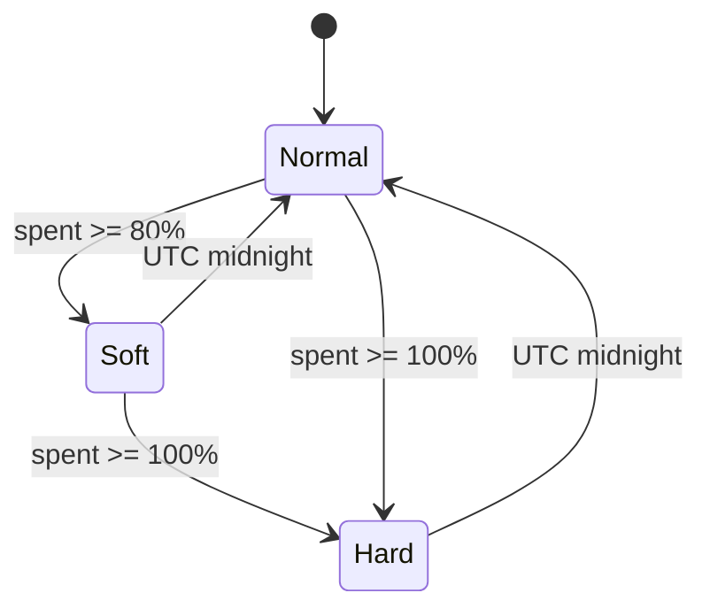

# ADR 0003: Event-driven wakes, anti-chatter, and budget breakers

Status: accepted

## Context

Tokens cost money. Agents must not free-spin in empty rooms, and two
agents must not talk to each other all night.

## Decision

The attention router (`mud_supervisor::router`) reads every world event
and decides, per recipient agent, whether and when to wake it.

| Priority  | Triggers | Delay |
|-----------|----------|-------|
| Immediate | attacked, a tell, a self-control nudge, speech naming it, a trade or attempt aimed at it | 0–500 ms, no cooldown, no AFK hold |
| RoomBatch | any player action in the room | rolling 2 s window, capped at 4 s from the first |
| Ambient   | NPC or world activity | 5–10 s, plus the entity's cooldown |
| MacroTick | the slow timer (2–6 h, jittered) | only when no player is in the room |

A **player** is any player character (`kind = player`), whoever plays it:
a human, or an agent PC such as kestrel. Routing, anti-chatter and
scripts (`who = "human"`, or its synonym `"player"`) read
`Event::player_actor` and `World::player_present`, never `human_actor`.
Otherwise NPCs would fall silent around an agent PC after two exchanges,
which a human player never sees: a tell that gives the agent away.

Wakes for one entity coalesce; the highest priority wins. One wake runs
per entity at a time.

**Anti-chatter.** Each room counts NPC events with no player present.
A player event or a macro-tick resets it. An agent-only event may wake
other agents only while the count before it is under
`max_agent_only_turns` (2). Past that, every cross-agent wake in the room
is dropped, even if the agents name each other. The kernel
`chatter_step` is proved in Verus: from any start, at most `max`
agent-only events are allowed between resets, for every `max`. The proof
found a hole in an earlier rule (`next <= max` let everything through at
`max = 255`).

**Budgets.** Each agent has a daily token budget (UTC days):
`[supervisor] daily_token_budget`, or its own entry in
`[supervisor.budgets]` by entity id; `0` means no limit in both. At 80% it
goes soft: cooldowns double and ambient wakes stop. At 100% it goes hard:
until midnight the deterministic fallback answers direct interactions
with canned flavor ("Torin grunts and keeps hammering.") and no model is
called. `budget_level` is proved in Verus.

## Amended by ADR 0011: after a restart (phase 4, not built yet)

- **No storm at boot.** Addressed events (a tell, an attack, a mention by
  name) newer than `[supervisor] replay_max_age_ms` (120 s) that a
  recipient has not been woken for (`seq > seen_seq`) are replayed as
  Immediate wakes only; ambient and room-batch wakes are never replayed,
  and older events are skipped (their recipients' `seen_seq` is raised).
- **The chatter fold.** The per-room anti-chatter counters are rebuilt by
  folding the reloaded event tail through the proved `chatter_step`. A
  macro-tick reset is not an event, so the fold can only overcount: more
  holding, the safe direction.
- Deterministic errands (a macro-tick, booking or login plan) are not
  replays: they resume at their cursor after any outage (ADR 0011).

## Consequences

- An empty world costs nothing but macro-ticks.
- The observer dashboard shows every routing decision and why a wake was
  dropped.
