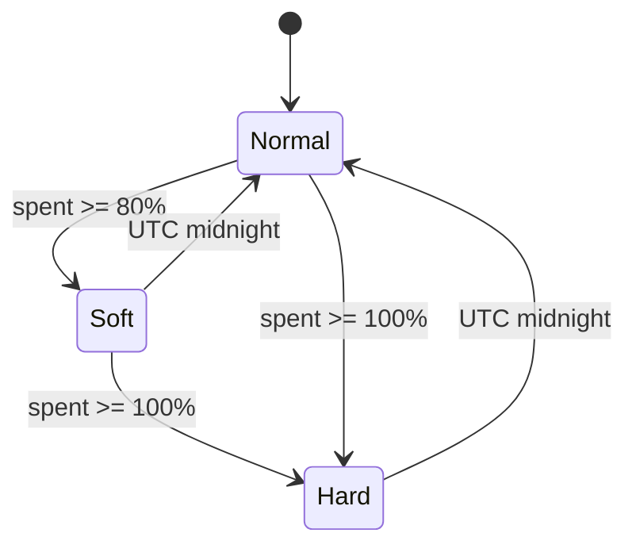

# ADR 0003: Event-driven wakes, anti-chatter, and budget breakers

Status: accepted

## Context

Tokens cost money. Agents must not free-spin in empty rooms, and two
agents must not talk to each other all night.

## Decision

The attention router (`mud_supervisor::router`) reads every world event
and decides, per recipient agent, whether and when to wake it.

| Priority  | Triggers | Delay |
|-----------|----------|-------|
| Immediate | attacked, a tell, a self-control nudge, speech naming it, a trade or attempt aimed at it | 0–500 ms, no cooldown, no AFK hold |
| RoomBatch | any player action in the room | rolling 2 s window, capped at 4 s from the first |
| Ambient   | NPC or world activity | 5–10 s, plus the entity's cooldown |
| Booked    | a wake the agent booked for itself (`mud_wake_me`, ADR 0008) | when due, if the agent is ready (see below) |
| MacroTick | the slow timer (2–6 h, jittered) | unless another player acted in the room within `macro_defer_ms` (amended 2026-11-26) |

A **player** is any player character (`kind = player`), whoever plays it:
a human, or an agent PC such as kestrel. Routing, anti-chatter and
scripts (`who = "human"`, or its synonym `"player"`) read
`Event::player_actor` and `World::player_present`, never `human_actor`.
Otherwise NPCs would fall silent around an agent PC after two exchanges,
which a human player never sees: a tell that gives the agent away.

Wakes for one entity coalesce; the highest priority wins. One wake runs
per entity at a time.

**Anti-chatter.** Each room counts NPC events with no player present.
A player event or a macro-tick resets it. An agent-only event may wake
other agents only while the count before it is under
`max_agent_only_turns` (2). Past that, every cross-agent wake in the room
is dropped, even if the agents name each other. The kernel
`chatter_step` is proved in Verus: from any start, at most `max`
agent-only events are allowed between resets, for every `max`. The proof
found a hole in an earlier rule (`next <= max` let everything through at
`max = 255`).

**Budgets.** Each agent has a daily token budget (UTC days):
`[supervisor] daily_token_budget`, or its own entry in
`[supervisor.budgets]` by entity id; `0` means no limit in both. At 80% it
goes soft: cooldowns double and ambient wakes stop. At 100% it goes hard:
until midnight the deterministic fallback answers direct interactions
with canned flavor ("Torin grunts and keeps hammering.") and no model is
called. `budget_level` is proved in Verus.

**Budgets survive a restart (ADR 0011, phase 3).** The day's spend is two
tallies, what the supervisor metered and what littleguy's ledger
reported, and the breaker counts both. The day rolls only forward, so a
clock set back never resets a spent budget. Each wake's close stores the
tallies with its turn, and the boot restores them and primes each
littleguy meter from its ledger: a restart neither bills a ledger row
twice nor forgets today's spend, and an agent at its hard stop is still
stopped after a restart. The kernels are proved (ADR 0006).

## Amended by ADR 0011: after a restart (phase 4)

The router's waiting wakes and the chatter counters are not stored. The
boot derives them from the reloaded event log (`Router::replay`, called by
`Supervisor::open`):

- **No storm at boot.** Each agent has a replay floor: the last event a
  committed wake of it consumed (`seen_seq`, which commits with the wake's
  first effectful command or its close), or the world's last seq when it
  has no stored row yet. An addressed event (a tell, an attack on it,
  speech naming it) after the floor and at most `[supervisor]
  replay_max_age_ms` (120 s) old is replayed as an Immediate wake, through
  the same rules as a live event (the anti-chatter hold included). Room
  batches and ambient wakes are never replayed, and an older event is not
  replayed at all. So a tell that arrived just before a crash is answered
  once: not twice (its answer committed the floor past it), and not never
  (a crash before the answer committed leaves it above the floor). The
  replayed routing decisions are in the observer's boot report, and a
  replayed wake's reason reads `replayed tell by …`.
- **The chatter fold.** The per-room counters are rebuilt by folding the
  whole log, oldest first, through the proved `chatter_step`. A reloaded
  event reads whether a player saw it from its recipients, since no human
  is online at boot. A macro-tick reset is not an event, and a player who
  was in the room but did not perceive the event is not counted, so the
  fold can only hold more than the live counters did: the safe direction
  (`lemma_fold_holds_at_least`, ADR 0006). A tell has no room: it counts
  in the rooms its sender and recipient stood in when it was sent, which
  the engine records on the event (`party_rooms`), so the fold counts it
  in the same rooms as the live counter after they move. A tell from an
  older log, without those rooms, holds every room. When the log does not reach
  back to the world's first event, a room's count before its first logged
  event is unknown; such a room, and every room the log never shows,
  starts held at the bound until a human or a macro-tick resets it.
- Deterministic errands (a macro-tick, booking or login plan) are not
  replays: they resume at their cursor after any outage (ADR 0011).

## Consequences

- An empty world costs nothing but macro-ticks.
- The observer dashboard shows every routing decision and why a wake was
  dropped.

## Amended by the autonomy work: booked wakes and the chatter hold

A booked wake (ADR 0008) sits between the macro tick and everything a
player causes. Delivering one never steps a room's chatter counter: it is
neither a human nor a macro tick, so it cannot reset a quiet room. Two
agents could still chat all night by booking wakes for each other, so a
due booking waits while its agent is **chatter-held**: its room's
agent-only turns are spent (`agent_only_turns >= max_agent_only_turns`),
another agent is in the room, and no player but the agent itself is
there. A lone agent is never held by it. The hold ends with the next
reset (a human's act or a macro tick) or when a player arrives, and the
booking fires then; the observer shows `booking ... held` once per hold.
A booking also waits while its agent is away for a spell (`afk_until`),
offline, out cold or at its hard cap. No hold outlasts
`booking_max_late_ms` past the booking's due time: after that the
booking is dropped (ADR 0008, Live expiry).

## Amended 2026-11-26: an idle player does not hold a macro tick back

The owner's run of 2026-11-26 showed the old rule's hole. After a
restart, kestrel (an agent PC, online, its mind not answering) and torin
(a persistent NPC) stood in the flooded cistern. Torin's tick was
"deferred: a player is present" every few minutes, forever: kestrel stood
there and never acted, and nothing else happened in the room.

The deferral exists because a present player's acts wake the agent
anyway. So a player now defers an agent's macro tick only while it acts:

- **The rule (`tick_deferred`, proved).** A tick waits exactly when a
  player other than the entity acted in its room less than
  `[supervisor] macro_defer_ms` (default 600000, 10 minutes of game time)
  before it. An act is an event of the room whose actor is a player
  present there now (`World::last_player_act`). With no such act it never
  waits, and once the room is quiet for the window it stays undeferred as
  the clock runs on (`lemma_quiet_stays_quiet`), so an idle player holds a
  tick back for at most the window. A tick that waits is tried again in 2
  to 10 minutes, as before.
- **Players, not humans.** The rule reads who acted and when, from the
  event log (`player_actor`, `at_ms`), never `human` or a tier: a human
  and an agent PC defer a tick alike, and an NPC beside either gets the
  same wakes. It is deterministic: the times are the game clock's.
- **A lost tick comes again soon (`tick_retry_ms`, proved).** A wake that
  carried a tick and never reached the mind (`MindError::Unavailable`, or
  a failure before any spend; a timeout is not one) used to leave the
  next tick on the normal 2 to 6 hour schedule. Kestrel's one tick fired
  at boot while the owner's lg was too old to start, and nothing woke it
  again. Now the next tick comes after a delay that starts at 3 minutes
  and doubles with each loss in a row, up to the cast's shortest interval
  (2 hours in crypt-v01), with a deterministic jitter of up to a quarter
  below it. No delay passes the cap, none is shorter than the one before,
  and the `n`-th is at least `min(3 min * n, cap)`, so a broken lg is
  tried less and less often, never every step. A wake that reaches the
  mind ends the run; the schedule it fired under stays. The time is
  stored as before (`SideOp::MacroSchedule`, `sup_entity.next_macro_ms`);
  the run's length is kept in memory and starts over at a boot. The
  observer feed shows nothing new.
