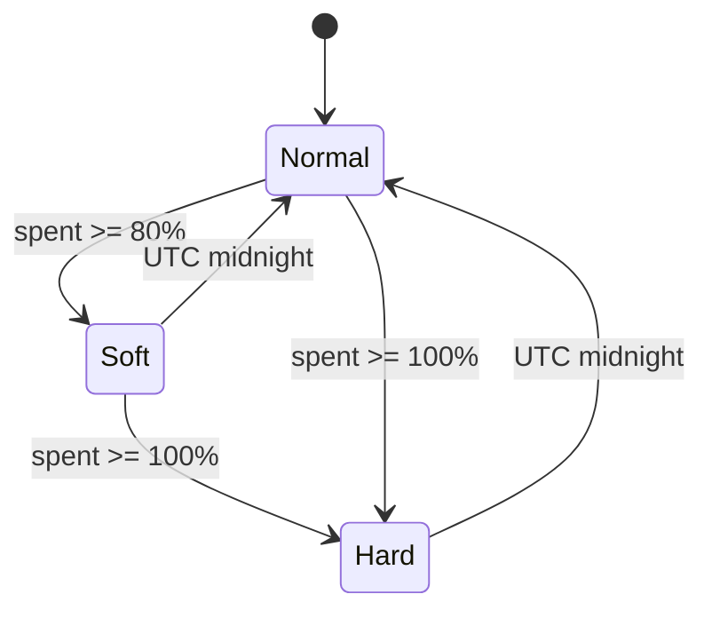

# ADR 0003: Event-driven wakes, anti-chatter, and budget breakers

Status: accepted

## Context

Tokens cost money. Agents must not free-spin in empty rooms, and two
agents must not talk to each other all night.

## Decision

The attention router (`mud_supervisor::router`) reads every world event
and decides, per recipient agent, whether and when to wake it.

| Priority  | Triggers | Delay |
|-----------|----------|-------|
| Immediate | attacked, a tell, a self-control nudge, speech naming it, a trade or attempt aimed at it | 0–500 ms, no cooldown, no AFK hold |
| RoomBatch | any human action in the room | rolling 2 s window, capped at 4 s from the first |
| Ambient   | agent or world activity | 5–10 s, plus the entity's cooldown |
| MacroTick | the slow timer (2–6 h, jittered) | only when no human is in the room |

Wakes for one entity coalesce; the highest priority wins. One wake runs
per entity at a time.

**Anti-chatter.** Each room counts agent events with no human present.
A human event or a macro-tick resets it. An agent-only event may wake
other agents only while the count before it is under
`max_agent_only_turns` (2). Past that, every cross-agent wake in the room
is dropped, even if the agents name each other. The kernel
`chatter_step` is proved in Verus: from any start, at most `max`
agent-only events are allowed between resets, for every `max`. The proof
found a hole in an earlier rule (`next <= max` let everything through at
`max = 255`).

**Budgets.** Each agent has a daily token budget (UTC days). At 80% it
goes soft: cooldowns double and ambient wakes stop. At 100% it goes hard:
until midnight the deterministic fallback answers direct interactions
with canned flavor ("Torin grunts and keeps hammering.") and no model is
called. `budget_level` is proved in Verus.

## Consequences

- An empty world costs nothing but macro-ticks.
- The observer dashboard shows every routing decision and why a wake was
  dropped.
