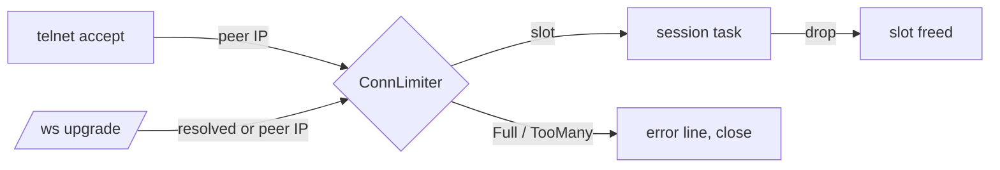

# ADR 0007: One limiter admits every player connection

Status: accepted

## Context

Each open terminal or telnet connection holds a task, a broadcast
receiver and a slot under the global cap. Before this, the caps were a
total (512) and timeouts for silent clients. One address could still log
in under 512 names and hold every slot, locking every other player out.

## Decision

- `mud_server::limits::ConnLimiter` admits a connection only when the
  total is under `[server] max_connections` (512) **and** the client
  address holds fewer than `max_connections_per_address` (8). It is shared
  by the web terminal and telnet, so the caps cover both together.
- A slot is an RAII `ConnSlot`; dropping it (the socket task ends) frees it.
- IPv4 and IPv4-mapped IPv6 addresses count as themselves. Other IPv6
  addresses count as their `/64`, since one subscriber usually holds a
  whole block. Connections whose address is unknown share one bucket.
- Web clients behind a reverse proxy are counted by the address autumn's
  trusted-proxy layer resolves from `X-Forwarded-For`, when
  `[server] trusted_proxies` names the proxy; otherwise by the TCP peer.
  Without that setting, every player behind a proxy would share one share.
- A refused client is told why ("The server is full" or "Too many
  connections from your address") and closed. The `/ws` upgrade always
  completes (autumn's `#[ws]` cannot refuse it), so the refusal is an
  error line and a close rather than an HTTP 429. autumn's own
  `realtime.max_connections` stays set to the same total as a backstop.
- The counting step `conn_step` is a mirrored kernel, proved in
  `formal/verus/src/connections.rs` (ADR 0006): admitted only under both
  caps, no underflow, no overflow, and the caps hold for every sequence of
  opens and closes.

## Consequences

- One address cannot exhaust the server; a household or NAT sharing an
  address shares 8 slots, which an operator can raise.
- A per-address cap is not an identity check: many addresses can still
  fill the total. Accounts (passwords) and login timeouts bound the rest.
