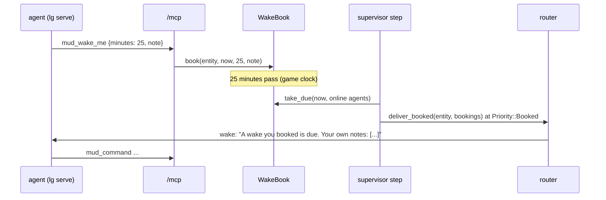

# ADR 0008: Wakes an agent books for itself

Status: accepted

## Context

Agents say "I'll check back in 25 minutes" and mean it. littleguy has a
`wake_me` tool, but its wakes run read-only, as a heartbeat does, so the
MCP server refuses every MUD call in them: the agent wakes, cannot look or
act, and the plan dies. The MUD's macro-ticks come every 2 to 6 hours,
far too late for "back in 25 minutes".

## Decision

- **`mud_wake_me(minutes, note)` books a real wake.** It is an MCP tool
  (and an in-process tool for harvest and plugin-agent minds) that books
  in the supervisor's `WakeBook`: 1 minute to 7 days ahead, at most 5
  pending per entity, a note of at most 280 characters (control
  characters dropped). `mud_cancel_wake(id)` drops one. Like every tool it
  acts as the token's own entity; no tool takes an entity argument.
- **The supervisor routes it like any wake.** Each step takes the bookings
  that came due for agents that are in the world and queues them at
  `Priority::Booked` (above a macro-tick, below everything a player
  causes). They merge into a wake already waiting. Budgets apply as to any
  wake (a hard-capped agent gets the fallback), one wake runs per entity
  at a time, and the mind may act. An agent that is not in the world (a
  Turing PC between sessions) keeps its booking until it is back.
- **The note comes back as the agent's own words, as data.** The wake
  message says a booked wake is due and gives the notes as a JSON array of
  strings. A note may quote what a player said, so the tool descriptions
  carry the untrusted-text warning too.
- **The prompt points at it.** The system prompt says to book a wake with
  `mud_wake_me` to come back to something, and that no other reminder tool
  can act in the world.
- **The observer shows each agent's bookings** (notes escaped by maud).
- **Bookings persist (ADR 0011).** The `sup_booking` table and its
  `BookingInsert` / `BookingDelete` ops exist since store v1; from phase 2
  the supervisor writes through them. `mud_wake_me` answers ok only after
  its row is written with `synchronous = FULL` (`Game::act`); a failing
  store answers `{"ok":false,"error_code":"store"}` and keeps nothing.
  Booking ids are `max(next_booking_id, max id) + 1` after a restart, so
  they never repeat. A booking is removed only with the first effectful
  command of the wake that carried it (or at that wake's close), in the
  same transaction: a crash before that leaves the booking, and it fires
  again as a new wake with a fresh id. A booking overdue past
  `booking_max_late_ms` at boot is dropped with an event. Until phase 2
  ships, bookings still live in memory and a restart drops them.

## Consequences

- "Back in 25 minutes" works, through the same budget, routing and typing
  gate as every other wake.
- An agent can book wakes in a chain; each costs a wake and counts against
  its budget, and at most 5 wait at once.
