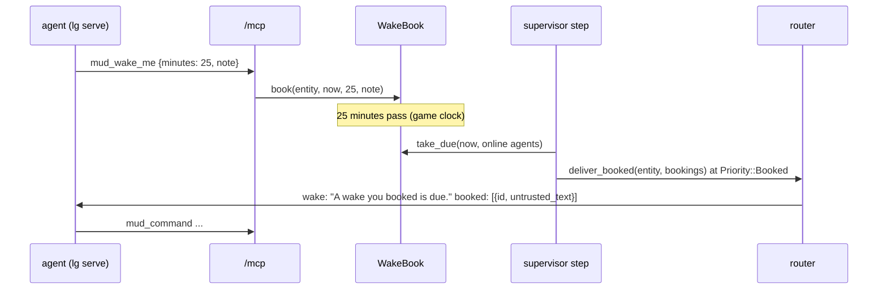

# ADR 0008: Wakes an agent books for itself

Status: accepted

## Context

Agents say "I'll check back in 25 minutes" and mean it. littleguy has a
`wake_me` tool, but its wakes run read-only, as a heartbeat does, so the
MCP server refuses every MUD call in them: the agent wakes, cannot look or
act, and the plan dies. The MUD's macro-ticks come every 2 to 6 hours,
far too late for "back in 25 minutes".

## Decision

- **`mud_wake_me(minutes, note)` books a real wake.** It is an MCP tool
  (and an in-process tool for harvest and scripted minds) that books
  in the supervisor's `WakeBook`: 1 minute to 7 days ahead, at most 5
  pending per entity, a note of at most 280 characters (control
  characters dropped). `mud_cancel_wake(id)` drops one. Like every tool it
  acts as the token's own entity; no tool takes an entity argument.
- **The supervisor routes it like any wake.** Each step takes the bookings
  that came due for agents that are in the world and queues them at
  `Priority::Booked` (above a macro-tick, below everything a player
  causes). They merge into a wake already waiting. Budgets apply as to any
  wake (a hard-capped agent gets the fallback), one wake runs per entity
  at a time, and the mind may act. An agent that is not in the world (a
  Turing PC between sessions) keeps its booking until it is back, but no
  longer than `booking_max_late_ms` past its due time (see Live expiry
  below).
- **The note comes back as the agent's own words, as data.** The wake
  message says, in fixed text, that a booked wake is due, and gives the
  notes on a line of their own, `booked: [{"id":…,"untrusted_text":…}]`.
  A note may quote what a player said, so it travels as `untrusted_text`
  everywhere (the wake message, `mud_wake_me`'s answer and its `pending`
  list), and the tool descriptions carry the untrusted-text warning too.
- **The prompt points at it.** The system prompt says to book a wake with
  `mud_wake_me` to come back to something, and that no other reminder tool
  can act in the world.
- **The observer shows each agent's bookings** (notes escaped by maud).
- **Bookings persist (ADR 0011, phase 2).** The wake book writes
  through the `sup_booking` table and its `BookingInsert` /
  `BookingDelete` ops. `mud_wake_me` answers ok only after
  its row is written with `synchronous = FULL` (`Game::act`); a failing
  store answers `{"ok":false,"error_code":"store"}` and keeps nothing.
  Booking ids are `max(next_booking_id, max id) + 1` after a restart, so
  they never repeat. A booking is removed only with the first effectful
  command of the wake that carried it (or at that wake's close), in the
  same transaction: a crash before that leaves the booking, and it fires
  again as a new wake with a fresh id. A booking overdue past
  `booking_max_late_ms` at boot is dropped with a `booking_dropped`
  observer event (the note stays out of the feed). A due booking is taken
  *in flight*, not deleted: a wake that never runs (its agent went
  offline) or runs the budget fallback gives it back, and an agent at its
  hard cap is not ready, so its bookings wait for the next UTC day. After
  a restart the observer lists the bookings read back from `world.db`.

## Consequences

- "Back in 25 minutes" works, through the same budget, routing and typing
  gate as every other wake.
- An agent can book wakes in a chain; each costs a wake and counts against
  its budget, and at most 5 wait at once.

## Amended by the autonomy work (phase 1): limits, holds, expiry

- **A daily cap.** An entity may book at most 24 wakes in one game-clock
  (UTC) day, besides at most 5 waiting at once. The limits are a proved
  kernel: the constants and `book_verdict` sit between mirror markers in
  `wakes.rs` and in `formal/verus/src/bookings.rs` (ADR 0006). The day's
  count commits with the booking, in the same write (`SideOp::Booked`
  beside the `BookingInsert`, joined in the store by the proved
  `dated_max`), comes back at boot from `sup_entity.booked_day` and
  `booked_today`, and a cancel never lowers it. The 25th ask is answered
  `{"ok":false,"error_code":"daily_cap"}`.
- **Who may book.** Only a Persistent or Turing entity with a mind
  (`Supervisor::can_book`). Ambient NPCs, mobs, humans and entities no
  mind plays are answered `no_wakes`, on MCP and in process alike, and
  ambient minds no longer see the wake tools or the wake habit in their
  prompt (ADR 0005): the wake line is `persistent_habits()`, appended
  only for minds that book.
- **Holds.** A due booking waits while its agent is offline, out cold, at
  its hard cap, away for a spell (`afk_until`), or chatter-held (ADR
  0003). It fires at the agent's next ready step, unless it is overdue
  by more than `booking_max_late_ms` (24 hours by default) by then: a
  hold never outlasts that limit, and the booking is dropped (see Live
  expiry).
- **Live expiry.** A booking overdue by more than `booking_max_late_ms`
  is dropped while the server runs too, held or not, with a `dropped`
  line, by the same proved `booking_disposition` the boot uses, so a running server and a
  restarted one agree. Its row is deleted through `Game::persist` (a lost
  delete is redone at the next boot).
- **The observer feed** shows `booking` lines: `booked`, `fired` (a wake
  carries it to its mind), `held` (once per hold), `dropped`,
  `cancelled` and `requeued` (a wake took it but never showed it to a
  mind). The note never goes in the feed; the boot's `booking_dropped`
  line stays.

## Amended by the autonomy work (phase 2): wake tools on the tick server

- A littleguy daemon reaches the wake tools on its `world` MCP server,
  whose effect is `internal` (ADR 0002), so the model sees them as
  `world__mud_wake_me` and `world__mud_cancel_wake`, and its prompts name
  them so. An unattended heartbeat tick may therefore book a real wake:
  the tick cannot act in the world, but the wake it books can. The world
  tools a tick reaches are reads (`world__mud_look`, `world__mud_sheet`);
  `mud__mud_command` and `mud__mud_events` sit on the `write` server, which
  lg refuses on a tick. The e2e test
  `a_real_tick_books_a_wake_through_the_world_server_and_cannot_command`
  runs a real tick on a scripted model: the booking lands in the
  `WakeBook`, and the command is refused and leaves no event.
- A wake message stays under lg's 64 KiB line cap however long a hold
  was (ADR 0002, the wire bound): the booked notes always go in, and the
  newest events that fit.
