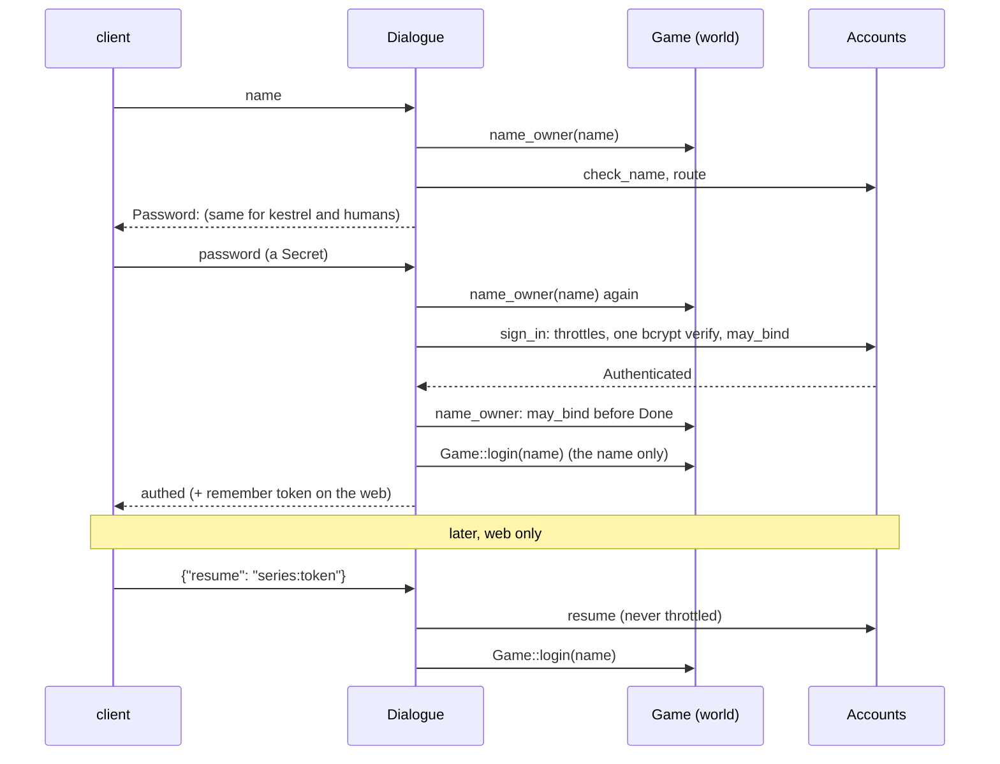

# ADR 0009: Accounts live outside the world

Status: accepted

## Context

- v0.1 logged a human in by name alone: `World::login(name)` made or
  resumed `pc_<name>`, and anyone who typed the name took the character.
- Players want to keep their progress, which means a secret per character.
- ADR 0004 hides which players are agents. That must hold at the login
  surface too: the hidden PC `kestrel` must answer a login exactly as a
  human account does.
- Views (`look_view`, `sheet_view`, `Event::view_for`, `who`) read
  `WorldState`, and the world store snapshots it on every command. A
  secret that entered `WorldState` would sooner or later leak through
  one of them.

## Decision

**A separate crate and a separate file.** `crates/mud-accounts` keeps
bcrypt hashes, web resume tokens (hashed) and each account's recent
login addresses (hashed with a per-file salt) in `accounts.db`, beside
`world.db` and never inside it. The file is created `0600`, uses WAL and
`busy_timeout`, and every query runs on a blocking thread behind one
mutex. The account is the character: its key is the lowercased name and
its entity is `pc_<key>`. The server binds a session with
`Game::login(name)` only after `Accounts` proved the login, so the world
sees a name and never a secret.

**Secrets stay out of the world.** Passwords, hashes and tokens never
reach `WorldState`, `world.db`, events, `Audit`, the observer, views,
`World::execute`, or any log line at any `MUD_LOG` level. Tests check it:
`session::passwords_never_reach_the_world` and
`tests/trace_log.rs::secrets_never_reach_a_trace_log`. At a password
prompt every input is the answer: never parsed, executed, echoed or
logged. `password`, `logout` and `quit` are session words the server reads
before the engine; the parser exports them as `SESSION_WORDS`, and a world
script may not declare a verb with one of those names. The Rhai engine
(`mud-script`) never holds an `Accounts` handle; it does not depend on
`mud-accounts`, and a test checks its manifest.

**Secrets come from the OS CSPRNG** (`getrandom`), never from `DiceRng`
or `mix(seed, …)`, and never change world state: bcrypt salts, the dummy
hashes, the address salt, resume tokens (autumn-web's 128-bit series and
token) and operator temporary passwords.

**Who holds a name.** `WorldState::name_owner` classifies a name as
`Free`, `Human`, `OtherPlayer` or `NonPlayer` (server-internal, never in a
view). A new name may not start with `pc_`: otherwise a character named
`pc_x` could be made while `x` is free, and once anyone made `x` (id
`pc_x`), the name `pc_x` would match that id and be locked out for good.
A saved human with such a name still comes back. `World::login` is a match on it.

**One proved route.** The dialogue's route table is a mirrored Verus
kernel (`formal/verus/src/login_route.rs`): `login_route`, `first_ask_of`,
`may_bind`. Proved for all inputs: an agent PC and every human account are
asked the same first question, `Password:` (R1); only a free name with no
account creates (R2); only an open legacy human with no account claims
(R3); a login is refused iff an NPC or a mob holds the name (R4); a
session binds only with a proved secret and only to a human or a free name
(R5). Who holds the name is read again before every account call and
before the login is done.

**One verify per answer.** bcrypt runs at a configurable cost (`[accounts]
bcrypt_cost`, 12) through the truncating API behind its own 72-byte check
(the `non_truncating_*` functions refuse exactly 72 bytes). A name with
no hash — an agent PC, a sealed legacy human, a free name typed at the
password prompt — verifies against a dummy hash. The dummy's cost follows
the mix of the stored hashes' costs, chosen per name from a salted hash of
it, so a dormant account at an old cost does not stand out from kestrel.
autumn-web supplies the password policy (length, its 10k weak list, the
name as context) and the remember-token primitives.

**Throttles before hashing.** Four keys on the proved backoff step
`throttle_step` (`formal/verus/src/throttle.rs`, S1–S8 and
`lemma_rate_bound`): (name, address), always checked; name, address, and
bcrypt work per address, all skipped for a (name, address) pair that has
logged in before, so an attacker elsewhere cannot hold the owner out at an
address the owner uses. Keys exist with or without an account, so kestrel
throttles exactly like a human. A success clears only the (name, address)
key. A key past its free count inside `forget_ms` is never evicted, so the
rate bound holds for every such key: a window of `L` ms admits at most
`free + 1 + L / min(base, max)` checked failures. One check per (name,
address) at a time, a semaphore around bcrypt, three wrong passwords per
connection, 20 answers per connection, and the login timeout is now a
total deadline (300 s). New characters are capped per IPv6 `/48` (or IPv4
address) per UTC day. The server refuses to start with an https
`public_url` and no `trusted_proxies`, and treats a forwarded request
without trusted proxies as `Peer::Shared` (no address keys).

**Web resume tokens.** A per-browser `series:token` is sent as an explicit
WebSocket message, never in a cookie, and is not rotated. "Stay signed in"
keeps it in `localStorage` for `remember_days`; otherwise it is a tab token
in `sessionStorage` that lives `reconnect_minutes` after the session's last
activity (live sessions slide it). Resume is never throttled (a guess needs
two 128-bit values). A wrong token for a live series deletes the series.

**Origin and close codes.** `/ws` refuses an `Origin` that is neither its
`Host` nor `public_url`. It closes with 1000 for quit, logout, idle and
"Too slow", and 1008 for refusals (the limiter, holds, too many tries, a
cross-site origin, a failed revalidation). The terminal reconnects by
itself only after an abnormal close.

**Telnet** sends `IAC WILL ECHO` before a secret prompt and `IAC WONT
ECHO` after the next input, and a CR ends a line (a following LF or NUL
is swallowed), for clients that send `CR NUL` with echo off. Telnet never
remembers a login.

**Sessions** read `password` (a private three-step change), `logout`
(forgets this browser) and `quit` before the engine; `help` adds a line
for them. Every `revalidate_secs` (30) a live session re-checks its
account: a lock, a reset, a sign-out or a password change elsewhere sets
`sessions_revoked_ms` and ends it.

**Logs.** `logging::subscriber` never lets the `tungstenite` and
`tokio_tungstenite` targets below INFO (their frame traces carry passwords
and tokens), whatever `MUD_LOG` says. `init` installs `LogTracer`, so
their `log` records take the same filter.

**Migration.** `world.db` is unchanged. A human with no account row is a
*legacy* character. `[accounts] legacy = "claim"` (the default) lets the
first password that passes the policy and is typed twice claim the
character within `legacy_claim_days` (30) of the first start with
accounts; claims are recorded (`origin = 'claimed'`, logged at info).
`"sealed"` leaves them closed (they answer `Wrong password.`) until
`mud account reset <name>` prints a temporary password that must be
changed at the next login. The operator CLI is `mud account
list|reset|lock|unlock|signout`.

## Rejected

- Accounts in `WorldState` or `world.db`: views and snapshots read them,
  and a second writer on `world.db` risks failed world saves.
- Cookies: a cookie is sent with every request; an explicit message keeps
  "no route trusts a cookie" (CSRF stays off).
- Rotating tokens: over a lossy WebSocket channel a lost `remember`
  message or a duplicated tab reads as theft.
- autumn's `hash_password` (its cost is a private constant 12), the
  `non_truncating_*` bcrypt API, and argon2 (a new dependency).
- Hiding whether a name is in use: `who` lists players and creation says
  "taken"; only the kind of holder is hidden.
- Persisted throttles, a per-name in-flight guard (a side channel), and a
  global creation cap on by default (an easy denial of service).

## Consequences

- **Two files to back up, together.** Losing `accounts.db` makes every
  human legacy, and so claimable, again. The server warns at start when
  `accounts.db` is new and the world already has human characters, and
  names the date the claim window closes; set `legacy = "sealed"` if
  `accounts.db` was lost.
- **The claim window leaks.** During the window, a probe that types a
  password learns whether a player name is an unclaimed human (its reply
  asks to confirm a new password), so kestrel can stand out by
  elimination. Strict Turing runs use `legacy = "sealed"`; the example
  config says so. Claim is also a takeover, not a share: the first
  stranger who types a password owns the character. `mud account list`
  shows claims (`origin`), and `mud account reset` gives a character back.
- Throttles reset on restart. At a new address the owner can be held by
  distributed guessing, at most `name.max_ms` after the last failure.
  Attackers behind the owner's NAT share the owner's (name, address) key.
  Behind an untrusted proxy the address keys are off.
- Squatted names are permanent entities and grow the snapshot.
- Telnet and plain http carry passwords in clear text; the server warns
  when either is bound off loopback without TLS in front.
- The Rhai engine never holds an `Accounts` handle, and `password`,
  `logout` and `quit` stay session words no script verb may take.
- Admin rollback of world state is not part of this decision; it belongs
  to runtime persistence (ADR 0012).
