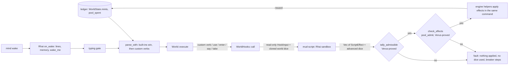

# ADR 0010: Sandboxed Rhai scripts: data in, data out

Status: accepted (v0.2). Amended: ledgered rewards are accepted and built
(see "Ledgered rewards"); scripts may mint money and items as quest
rewards, only from pack pools and only into the ledger.

## Context

- ADR 0001: the server owns physics. Every state change is a parsed line
  resolved by `World::execute`.
- ADR 0004: tiers never leak. Nothing a player, an agent or a view sees may
  tell a human from an agent PC.
- ADR 0008: agents book wakes, and their notes may quote players.
- Builders want rooms, items, verbs and simple NPCs to behave without a
  recompile. TOML `script` rules (`cast.toml`) and `SkillEffect` cover a
  little of that; anything conditional needs code.

## Decision

Packs may ship Rhai scripts (`worlds/<pack>/scripts.toml` and
`scripts/**/*.rhai`). Scripts are **data in, data out**: no script holds
the world, the state or a writable view.

### Two hook families

- **World hooks** (a room's `on_enter`/`on_speech`, an item's
  `on_take`/`on_use`, a custom verb) return a closed list of effects:
  `msg`, `narrate`, `refuse`, `unlock`, `lock`, `set_flag`, `clear_flag`,
  `mark`, `unmark`, `heal`, `hurt`, `reward`. The engine admits the list
  all-or-nothing through `tally_step`/`tally_admissible` (at most
  `max_effects`, at most one heal/hurt, at most one reward, a `refuse`
  only alone and only in a verb or `on_use` hook), then `check_effects`
  validates each effect against the world (texts 1 to 500 printable
  characters, a lock on that exit, valid flag names, no `hurt` in a safe
  room, the actor present, a reward within its pool's budget).
  Only then does it apply them with its own helpers, in the same `Ctx`,
  `CommandResult`, events and commit.
- **Mind scripts** return command lines (and optionally memory and a
  `wake_me`). The lines go through the typing gate, `parse_with` and
  `World::execute` like any mind's. A mind script that calls an effect
  constructor faults.

### Hook points

At most one hook per command, and nothing a hook does sets off another.
Custom verbs and `use` of an item with no engine use decide the command
(`REFUSED`, `SCRIPT_FAILED`, `NOT_HERE`). Enter, say and take react after a
command that worked; their faults never fail it. A hidden mover sets off
no `on_enter`, as it emits no arrival. Login, respawn, ticks and effects
set off nothing. A scripted death skips every remaining effect but `msg`.

### The sandbox (`mud-script`, the only crate with rhai)

- `rhai = "=1.27.0"` with `std, sync, no_float, no_time, no_module,
  no_custom_syntax, only_i64`. Never `unchecked`: it compiles out the
  `set_max_*` calls, so the build fails instead of running unbounded.
- `Engine::new_raw` with only the arithmetic (checked), logic and range
  iterator packages. Never `Engine::new` or `StandardPackage`:
  `LanguageCorePackage` carries `sleep`, and the std collection packages
  hold natives that cost far more than one operation each (deep map
  equality, `map` over a closure). A curated set replaces them: array,
  map and string basics, effect constructors, dice, `log`, UTC time.
  `eval`, `print`, `debug` are disabled; closures are off.
- Fixed limits: 16 call levels, expression depth 64/32, strings 1024
  bytes, arrays and maps 64 (aggregate when built), 128 variables, 256
  functions. Pack limits: `max_operations` (1 000 to 10 000), which is
  also the budget of a deterministic **work counter** that natives whose
  cost grows with their input charge. No wall clock, no `on_progress`.
- Rhai checks the size of a map it builds or a function returns, not of
  one grown in place by index assignment, and a copy (`let b = m`, a
  function argument) costs one operation whatever its size. So the
  sandbox's `on_var` hook charges every read of a variable whose value is
  over the caps one work unit per entry and per 64 string bytes; reads
  within the caps are free. `this` is disabled, since a method call binds
  it without a variable read. A map of 300 arrays copied in a loop, which
  took 0.8 s per call before, now runs out of work in under 1 ms.
  `tests/cost.rs` runs the hostile loops at the `max_operations`
  ceiling; the worst, a copy loop over a 63-entry map, takes about 10 ms
  in a release build (CI asserts under 25 ms). The ceiling was 20 000
  until that loop measured about 30 ms there. The shipped hooks run in
  about 20 µs.
- Views (`View`) are O(1)-clone, read-only JSON views; reading a missing
  key faults, so a dry run finds typos. Top-level code is refused: a
  script file is functions only. Every call runs under `catch_unwind`.

### Player text: `Untrusted`

Player text (speech, a verb's arguments) and booked-wake notes reach a
script only as `Untrusted`. **A script cannot quote player text.** It can
learn only whether each of at most 16 dictionary words of its own choosing
(2 to 32 of `[a-z0-9']`, written in the pack) appears in one text, per
call (`has_word`, `has_any`, `pick`, which returns the script's own
word). `to_string` gives `[player text]`; `+`, `==` and `!=` with a string
fault; effects, `log`, lines and memory accept only strings. Substring
tests and a length were removed: with them a script could rebuild a text
character by character within its budget.

### Determinism

Hooks get a **clone** of the world dice; the world takes the advanced
clone back only when the effects are admitted and valid, so a faulted or
panicking hook consumes no dice. Mind dice are
`mix(seed, entity, wake_id, "rhai")`. Time comes in as `now_ms`. Budgets
are operation and work counts. Same pack, script versions per seq, seed,
commands and clock give the same snapshot and event log (tested).

### Views carry `kind` only

`HookInput`, actor and cast facts, mind events and the mind ctx carry
`kind` (`player`, `npc`, `mob`), never `tier`, `human`, a runtime or a
mind. `ctx.cast` lists only NPCs and mobs. Hale's shipped script greets
kestrel exactly as a human (tested).

### Breakers and admission, proved

`hook_step`/`hook_allowed` and `tally_step`/`tally_admissible` live in
`crates/mud-world/src/hooks.rs`, mirrored in `formal/verus/src/hooks.rs`
(ADR 0006): a hook runs at most `max` consecutive faulting times for every
`max`, stays tripped until the scripts change or are reloaded, and the
saturating tally admits exactly the lists the plain rule admits
(`max <= 16`), at most one reward among them. The reward pools' kernels
(`pool_admit`, `pool_roll`, `pool_period`) live in
`crates/mud-world/src/rewards.rs`, mirrored in
`formal/verus/src/rewards.rs` (see "Ledgered rewards"). Hook breakers persist in `WorldState.hook_faults`; mind
breakers live in memory in the `ScriptHost`, where the Scripts panel shows
them (faults/max, TRIPPED), and reset on any new version, reload or
re-arm. A fault from a wake that started before a reload counts for
nothing.

### Reload, versions, records

The version is `rhai-` plus FNV-1a-64 over every script byte. `set_hooks`
records it in `WorldState.scripts_version` and a marker event no entity
perceives, at start (when it changed) and on every reload, so history says
which version ran from which seq. The store does not keep script sources;
an operator who keeps the pack in git matches the hash to a commit.
`POST /observer/scripts/reload` compiles, validates and dry-runs off the
async workers and swaps between two commands; every successful reload
reopens every hook and mind breaker. A reload that would change which
entities run on Rhai is refused: that needs a restart. A refused reload
answers 422 with its problems, logs a warning and publishes a
`ScriptsReloadRefused` row to the observer's feed (the panel's button
shows no response body). The bundled pack has no folder to read again:
its reload **re-arms** the scripts running now (breakers reset, marker
recorded), since its hook faults survive a restart with the same version
and nothing else could reopen them.

Mind memory saves are conditional: a wake reads the memory with the
mind's reset count, and its save is dropped if an operator's Reset
memory came in between, so a reset is never undone by a wake that was
already running.

### Runtime opt-in, and TOML as the net

A mind binding may set `runtime = "rhai"`; the server then runs that
entity on its script whatever `[minds]` maps its tier to
(`[scripts] allow_runtime_override = false` vetoes it). crypt-v01 does so
for Hale, so in the owner's live configuration he is a free, deterministic
guard instead of a plugin-agent call. TOML rules stay the fallback: the
TOML plan is computed dry, and its `nth` counters move only when it runs.

### Pack data, and the proposed repository rule

Limits are pack data (`[limits]` in `scripts.toml`) because they change
outcomes. Proposed `CLAUDE.md` rule, for the owner to adopt: "Scripts are
data in, data out: world hooks return `ScriptEffect`s the engine admits
and validates; mind scripts return lines. rhai lives only in mud-script,
on `Engine::new_raw` with the curated natives, never `Engine::new()` or
`StandardPackage`."

## Alternatives rejected

- **Lua or WASM.** Lua needs C and its own sandboxing story; WASM needs a
  toolchain per builder. Rhai is pure Rust, embeds in a few lines, and
  compiles the dangerous parts out.
- **Scripts that call `execute`.** A side door around physics, and a
  recursion hazard.
- **A raw substring test on player text.** It lets a script reconstruct
  the text.
- **`StandardPackage`.** `sleep`, and natives with unbounded per-operation
  cost.
- **Wall-clock timeouts.** Not deterministic.
- **A plain-map ctx.** Cloned per access: O(n) per operation.
- **Placeholder dice.** The world never hands its dice out; it lends a
  clone.
- **Effect trees, cascades and ticks.** One hook per command keeps cost and
  reasoning bounded.
- **Unledgered item and money creation.** A script that could make money
  or items directly would break conservation with nothing to audit. A
  reward comes only from a pack pool and is always in the ledger (below).
- **A pool in `scripts.toml`.** A pool is physics; an operator reloading
  scripts must not be able to change how much money the world makes.
- **Partial rewards.** Paying what is left of an ask would let a script
  drain a pool to the coin without knowing it; an ask fits whole or the
  hook faults, and `ctx.pools` lets the script check first.
- **Per-period counts kept forever.** Only the current period of a pool is
  counted (`pool_spent`); the ledger keeps the history.
- **A `by_human` flag.** It would leak tiers.
- **Storing sources for replay.** Deferred.

## Ledgered rewards (accepted)

The owner chose that scripts may create items and money as quest rewards,
through a ledgered reward source. Earlier v0.2 scripts minted nothing, and
random play tested exactly that; now random play tests that money and
items are conserved **except for ledgered mints, which it counts exactly**.

- **A pack-declared source.** `economy.toml` declares
  `[rewards.<pool>]`: `currency = 60`, `items = { healing_draught = 3 }`,
  `per = "day"` (the UTC day of the game clock `now_ms`) or `"ever"`
  (never refills). A pool is physics, so it lives in the world pack, not
  in `scripts.toml`; the pack validator checks the id (1 to 32 of
  `[a-z0-9_]`), the currency (0 to 1 000 000), the item ids and counts
  (1 to 1 000 each), that the pool gives something, and refuses unknown
  keys.
- **One engine-validated effect.** `reward(pool, #{ currency, items })`
  (or `reward(pool, n)`) builds `ScriptEffect::Reward { pool, currency,
  items }` of the class `Mint`. Admission allows at most one mint per
  hook; a refuse stands alone, so a refused command never mints.
  `check_effects` refuses an unknown pool, an item the pool does not
  offer, a negative or empty ask, more than 16 items in one reward, an
  absent actor, and any ask past what is left of the pool's budget for
  the period: never past it, and never partly. Hooks see what is left in
  `ctx.pools`, so a careful script asks only for what fits. Mind scripts
  cannot mint (`reward` is a hook-only constructor).
- **Every mint recorded.** `WorldState.mints` is the ledger (the event
  seq, pool, period, hook, entity, currency, every item id and prototype
  made, `at_ms`), and `WorldState.pool_spent` holds what each pool has
  given in the period it counts in; both are `serde(default)`, so old
  snapshots load, and both are in every snapshot. A mint emits
  `StateChange::Minted` (beside the `currency` change and an `item` change
  from nowhere), a `system` event only the receiver perceives, with the
  reward in `data`, and an `Audit::Minted` for the observer's feed. The
  Scripts panel lists each pool, what is left, and what its ledger holds.
  Items are made with `new_item` and given to the actor: never stock,
  never a sale. A scripted death before the reward skips it, logged; a
  pool the pack drops gives nothing more, and its ledger stays.
- **Periods on the game clock.** A period is `now_ms / 86 400 000` for a
  per-day pool and 0 for `ever`. Only the current period is counted: a
  later period starts from zero, and a clock set back keeps the later
  count, so it never refills a pool. No wall clock is read.
- **Conservation, counted.** The engine and script property tests assert
  that total money equals the start plus the ledger's currency, that
  every item id above the start's `next_item` is named by the ledger (no
  login happens during the run), that each is held once or was used up,
  and that `WorldState::check_rewards` holds: no pool past its budget,
  and each pool's count equal to its ledger for the period.
  `WorldState::check` refuses a ledger that names an item twice or ahead
  of `next_item`.
- **The proof.** The admission tally gains a `mints` count, and
  `tally_admissible` adds `t.mints <= 1`; `lemma_admission_is_exact`
  covers it and `lemma_admitted_mints_at_most_once_and_never_with_refuse`
  states the consequence. A new mirrored module,
  `crates/mud-world/src/rewards.rs` and `formal/verus/src/rewards.rs`,
  proves `pool_admit(spent, budget, ask) -> (bool, u64)` (admitted iff it
  fits in what is left; admitted means exactly `spent + ask <= budget`;
  refused changes nothing; no overflow), `pool_roll` (a later period
  starts at zero; the period never moves back) and `pool_period`; and,
  for every sequence of asks in a period, spent never passes the budget
  and equals the start plus exactly the admitted asks
  (`lemma_run_never_passes_budget`), and for every sequence of clock
  readings and asks across periods, the count of the period a pool counts
  in never passes its budget (`lemma_every_period_keeps_its_budget`).
  `PAIRS`, ADR 0006 and `formal/verus/README.md` list it.
- **Untouched rules.** Rewards never take player text; the amounts are
  pack integers or script integers within the pool, and the receiver's
  line names only numbers and pack item names. A reward is not a sale:
  shops and the `PolicyTradeRequired` rule are unchanged.
- **crypt-v01 uses it.** `report` in the Town Square (`rooms/square.rhai`):
  with the skeletal warden down and its notched grave-blade in hand, Hale
  pays 20s and a healing draught from `warden_bounty` (60s and three
  draughts a day), once a day per player (a mark), and says so when the
  purse is spent.

## Consequences

- Per command at most one hook, bounded by the operation and work limits;
  mind and reload CPU runs on blocking threads.
- A faulting hook is visible in the observer (feed and Scripts panel) and
  trips after `max_consecutive_faults`; the Reload button reopens it.
- History is keyed by script version.
- Money and items grow only by ledgered mints, each bounded by a pack
  pool's budget per period; the ledger grows by at most the pools' budgets
  a day.
- Rhai minds run live where a binding opts in; without one, nothing
  changes for LLM-run entities.
- `mud check`, `mud serve` and every reload compile, validate and dry-run
  every script, and report every problem at once.
