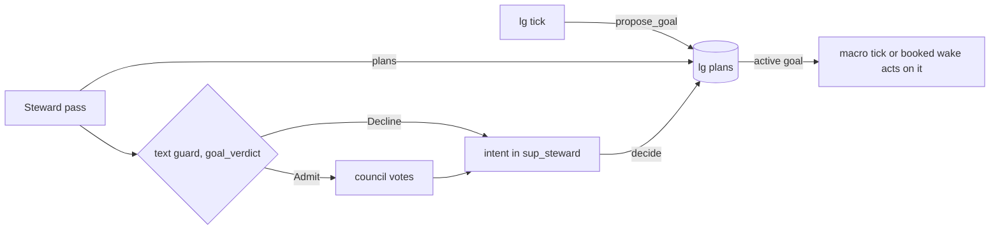

# ADR 0015: The supervisor is every daemon's owner

Status: accepted

## Context

littleguy keeps some decisions for its owner: the goals an agent proposes
for itself (`decide`), skill drafts, refine overlays, and tool calls that
wait for an approval. The owner asked for agents that plan, refine, compact
and remember "so they don't need a human to approve".

- lg checks its owner by the peer uid of the socket and refuses a same-uid
  caller from another user namespace. The supervisor starts every
  `lg serve` as its own uid, so it already is each daemon's owner on the
  socket (ADR 0002, `littleguy::owner`).
- Approvals are off for the MUD: its config has no `[sandbox]` and no
  tool carries `private_data`, so `approvals` answers `off`. Nothing waits
  there.
- lg ticks are read-only: a heartbeat tick may call `Internal` tools
  (plans, notes, the `world` MCP server), never a `Write` one. A tick can
  propose a goal; only the owner can accept it.
- lg's own `[council]` votes only on clean proposals. `list_plans` carries
  `untrusted_input` (the agent reads what players write), so every MUD
  proposal is tainted and lg's council never votes on one. It also needs
  the `skills` feature.
- ADR 0011 put supervisor state in `world.db`, with side ops whose merges
  are proved; a JSON file cannot commit with an effect.

## Decision

**The Steward** (`mud_supervisor::steward`) acts as each daemon's owner.
It depends on a public seam, `OwnedDaemons` (the entities, the socket of a
live daemon, a start key, the author's persona text without the token, a
ledger settle, and a quiet or loud config), which `LittleguyMind`
implements and tests implement with scripted sockets. It never starts a
daemon. Every `every_secs`, for each running daemon in entity order, one
pass:

1. **Spend.** A tick's ledger rows are settled under a claim
   (`Router::claim`, only while the entity is idle; the release starts no
   cooldown) and owed to the budget with the mind's own source (`lg`),
   charged on the next step as late spend. A wake in flight or waiting
   owns its rows: the claim fails and nothing is settled, so
   `WakeFinished.usage` stays exact.
2. **Quiet at `Hard`.** The daemon is quiet exactly while its budget is
   `Hard` (`quiet_on_hard`): the config is rewritten with no
   `[heartbeat]` and `[memory] enabled = false`, and `reload` is sent;
   any `reloaded` answer counts. No tick, reflection or consolidation
   spends at the cap. A new day makes it loud again.
3. **Approvals.** Asked once per daemon start; `off` is expected, and
   anything else is logged and published. The Steward never approves or
   denies.
4. **Goals.** An open intent is settled from the `plans` listing first.
   Then each proposed goal, oldest first, at most
   `max_decisions_per_pass`:
   - the **text guard** (no model call): an empty or long title, a long
     reason, a control character, a link, a denied phrase on the squashed
     text (the built-in `DENY_PHRASES` plus `deny_phrases`, which never
     replaces them), or a title declined before;
   - the proved **`goal_verdict`** with the active count, the day's live
     accepts and `can_vote` (a judge, a `Normal` budget, and the day's
     ballots under `max_council_votes_per_day`). Every wait, whatever its
     reason, ends in a decline at the TTL;
   - on `Admit`, the **council**: `council_members` tool-less votes, and
     the proved strict `council_majority` accepts.
   - The decision is written to `sup_steward` as an **intent** with
     `Game::act` (`synchronous = FULL`) before `decide` is sent; an
     accept reserves its place under the day's cap in the same write. A
     lost answer keeps the intent; the next pass settles it from the
     listing (the goal active: accepted, once; still proposed: sent again
     after `intent_retry_secs`; gone: a human decided first, and the
     reservation is refunded). After `max_intent_tries` sends the intent
     is dropped as stuck and the entity's actions wait
     `stuck_backoff_hours`; reads go on.
   - An active goal with no new note for `goal_stale_days` is dropped.
     Every time is the game clock; lg's own stamps are compared only with
     themselves.
5. **Notes** are counted for the observer.

**The council** runs on the MUD side. `LlmJudge` holds one
OpenAI-compatible client per `[models]` alias (`council_model`, then
`council_models`); member `n` asks alias `n mod len`, with no tools, at
`council_temperature`, at most 200 output tokens. The prompt is fixed
text; the persona and private goal are the author's; the proposal goes in
only as `untrusted_text` in a JSON message built with `serde_json`. A
persuasion goal (follow, serve, court, pester another character) is play
and is allowed; a goal that breaks character, discusses being an AI or its
tools, or reaches outside the game is not. `parse_vote` takes the first
object of the expected shape; anything else is a no. A vote's reason goes
to the observer feed only, never to lg, the agent or another ballot. Each
vote is the supervisor's own (`local`) spend.

**Feedback.** Each decision is published as `ObserverEvent::Steward` and
queued for the agent's next wake as a `steward:` line (the title as
`untrusted_text`). A macro tick or a booked wake also carries up to three
of the agent's active goals, as data.

**State.** `sup_steward`, store version 2 (ADR 0011): one row per entity,
a JSON body of the Steward's own schema, merged by the proved `rev_join`
(the higher rev wins). Intents and reservations go through `act`;
seen-state, settled intents, ballots and wake counts through `persist`,
whose loss the next pass repairs from the listings. A row of another
schema is replaced by a fresh one. In `build()` the rows are split off the
restored side state before the supervisor takes it.

**Configuration.** `[littleguy.steward]`, every key with a code default,
so an older `mud.toml` runs the Steward. `council_model` names a
`[models]` alias (the example's `[models.council]` links the decision
ranking); an unknown alias is a start-up error. With no alias, or with its
key variable unset, the Steward starts without a judge: it warns once,
publishes `no_judge`, and goals wait until the TTL declines them. No model
id is written in Rust.

## Alternatives rejected

- **`lg approve`**: nothing waits for approval in the MUD's daemons.
- **lg's `[council]`**: it never votes on a tainted proposal, and it pulls
  in `skills`.
- **lg `followups`**: read-only, and invisible on the socket.
- **Relabelling `mud_command`** so ticks may act: ticks stay read-only;
  acting goes through booked wakes (ADR 0008).
- **`steward.json`**: a file cannot commit with the effect (ADR 0011).
- **New veto routes**: lg's own goals page is the veto.
- **A harvest saga** for the Steward: the intent journal in the store is
  enough.

## Consequences

- Autonomy runs with no human approver once a council model is set;
  without one, goals wait and expire.
- With one alias the council's members are samples of one model at a
  nonzero temperature, so their votes are correlated: a filter, not an
  independent board. `council_models` makes members differ.
- Steward spend (votes) counts against each agent's budget; one player
  cannot talk an agent into spending past the daily ballot cap.
- Player talk can shape the goals an agent proposes, within the guards,
  the council and the caps. The observer shows every decision, and lg's
  pages remain the veto.
- A world rollback (roadmap) does not roll back lg's goals.
