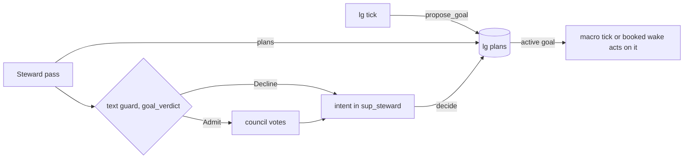

# ADR 0015: The supervisor is every daemon's owner

Status: accepted

Amended 2026-11-27: the Steward stores the head of its own move and sees a
move away and back between two passes (littleguy #124).

## Context

littleguy keeps some decisions for its owner: the goals an agent proposes
for itself (`decide`), skill drafts, refine overlays, and tool calls that
wait for an approval. The owner asked for agents that plan, refine, compact
and remember "so they don't need a human to approve".

- lg checks its owner by the peer uid of the socket and refuses a same-uid
  caller from another user namespace. The supervisor starts every
  `lg serve` as its own uid, so it already is each daemon's owner on the
  socket (ADR 0002, `littleguy::owner`).
- Approvals are off for the MUD: its config has no `[sandbox]` and no
  tool carries `private_data`, so `approvals` answers `off`. Nothing waits
  there.
- lg ticks are read-only: a heartbeat tick may call `Internal` tools
  (plans, notes, the `world` MCP server), never a `Write` one. A tick can
  propose a goal; only the owner can accept it.
- lg's own `[council]` votes only on clean proposals. `list_plans` carries
  `untrusted_input` (the agent reads what players write), so every MUD
  proposal is tainted and lg's council never votes on one. It also needs
  the `skills` feature.
- ADR 0011 put supervisor state in `world.db`, with side ops whose merges
  are proved; a JSON file cannot commit with an effect.

## Decision

**The Steward** (`mud_supervisor::steward`) acts as each daemon's owner.
It depends on a public seam, `OwnedDaemons` (the entities, the socket of a
live daemon, a start key, the author's persona text without the token, a
ledger settle, and a quiet or loud config), which `LittleguyMind`
implements and tests implement with scripted sockets. It never starts a
daemon. Every `every_secs`, for each running daemon in entity order, one
pass:

1. **Spend.** A tick's ledger rows are settled under a claim
   (`Router::claim`, only while the entity is idle; the release starts no
   cooldown) and owed to the budget with the mind's own source (`lg`),
   charged on the next step as late spend. A wake in flight or waiting
   owns its rows: the claim fails and nothing is settled, so
   `WakeFinished.usage` stays exact.
2. **Quiet at `Hard`.** The daemon is quiet exactly while its budget is
   `Hard` (`quiet_on_hard`): the config is rewritten with no
   `[heartbeat]` and `[memory] enabled = false`, and `reload` is sent;
   any `reloaded` answer counts. No tick, reflection or consolidation
   spends at the cap. A new day makes it loud again.
3. **Approvals.** Asked once per daemon start; `off` is expected, and
   anything else is logged and published. The Steward never approves or
   denies.
4. **Goals.** An open intent is settled from the `plans` listing first.
   Then each proposed goal, oldest first, at most
   `max_decisions_per_pass`:
   - the **text guard** (no model call): an empty or long title, a long
     reason, a hidden character (a control, a format character such as a
     bidi override or a zero-width space, a line or paragraph separator),
     a brace (no goal holds JSON, and a quoted vote must never reach a
     ballot), a link, a word that mixes ASCII letters with another
     script's (a homoglyph spelling), a denied phrase on the squashed text
     (folded first: fullwidth forms to plain letters, accents dropped; the
     built-in `DENY_PHRASES` plus `deny_phrases`, which never replaces
     them), or a title declined before;
   - the proved **`goal_verdict`** with the active count, the day's live
     accepts and `can_vote` (a judge, a `Normal` budget, and the day's
     ballots under `max_council_votes_per_day`). Every wait, whatever its
     reason, ends in a decline at the TTL;
   - on `Admit`, the **council**: `council_members` tool-less votes, and
     the proved strict `council_majority` accepts.
   - The decision is written to `sup_steward` as an **intent** with
     `Game::act` (`synchronous = FULL`) before `decide` is sent; an
     accept reserves its place under the day's cap in the same write. A
     lost answer keeps the intent; the next pass settles it from the
     listing (the goal active: accepted, once; still proposed: sent again
     after `intent_retry_secs`, but never at `Hard`; gone: published as
     `gone`). A `decide` that lg answers with an error ("not a proposed
     goal") reads the listing again at once. A reservation is never
     refunded: lg lists only proposed and active goals, so a goal a human
     declined and one our accept made active that the agent then finished
     look the same, and the cap errs on the safe side. After
     `max_intent_tries` sends the intent is dropped as stuck and the
     entity's actions wait `stuck_backoff_hours`; reads go on. A stuck
     accept keeps its reservation, since a queued `decide` may still run:
     the row remembers it, a later listing that shows the goal active
     settles it as accepted (published and noted once), and a new vote on
     the same goal that day reuses its place (in the proved day model, a
     refund followed by its ask).
   - An active goal with no new note for `goal_stale_days` is dropped.
     Every time is the game clock; lg's own stamps are compared only with
     themselves.
5. **Refine** (with `[littleguy] refine` not `off`; below).
6. **Notes** are counted for the observer.

**The council** runs on the MUD side. `LlmJudge` holds one
OpenAI-compatible client per `[models]` alias (`council_model`, then
`council_models`); member `n` asks alias `n mod len`, with no tools, at
`council_temperature`, at most 200 output tokens. The prompt is fixed
text; the persona and private goal are the author's; the proposal goes in
only as `untrusted_text` in a JSON message built with `serde_json`. A
persuasion goal (follow, serve, court, pester another character) is play
and is allowed; a goal that breaks character, discusses being an AI or its
tools, or reaches outside the game is not. `parse_vote` reads the top-level
objects of the expected shape, which must all agree: a member that
quotes the proposal before or after its own answer is no answer, and
anything else is a no. A vote that fails (the model is down) is a no. A vote's reason goes
to the observer feed only, never to lg, the agent or another ballot. Each
vote is the supervisor's own (`local`) spend.

**Feedback.** Each decision is published as `ObserverEvent::Steward` and
queued for the agent's next wake as a `steward:` line (the title as
`untrusted_text`). A macro tick or a booked wake also carries up to three
of the agent's active goals, as data.

**State.** `sup_steward`, store version 2 (ADR 0011): one row per entity,
a JSON body of the Steward's own schema, merged by the proved `rev_join`
(the higher rev wins). Intents and reservations go through `act`;
seen-state, settled intents, ballots and wake counts through `persist`,
whose loss the next pass repairs from the listings. A row of another
schema is replaced by a fresh one. In `build()` the rows are split off the
restored side state before the supervisor takes it.

**Configuration.** `[littleguy.steward]`, every key with a code default,
so an older `mud.toml` runs the Steward. `council_model` names a
`[models]` alias (the example's `[models.council]` links the decision
ranking); an unknown alias is a start-up error. With no alias, or with its
key variable unset, the Steward starts without a judge: it warns once,
publishes `no_judge`, and goals wait until the TTL declines them. No model
id is written in Rust.

**Refine** (phase 4). `[littleguy] refine` is `off`, `menu` (the code
default) or `free` (ADR 0016: council-approved model text in the
guardrails, with its own guards and controls; a Turing-tier agent still
uses the menu). With it on, lg's config gains `[refine]` (the pinned
CI `lg` is built with the `refine` feature) and the Steward owns the
agent's overlays. The Steward keeps its own view of lg's active version
(`pointer`) and checks every move. Since littleguy #122, each activate
also sends the pointer it read (`expected`), and lg refuses a move from a
pointer that moved (amended below):

- **The pointer check**, every pass: `overlays` (a read beside lg's loop)
  and the proved `pointer_verdict(lg, pointer, lg is late)`, since
  littleguy #124 inside the proved `head_verdict`, which also compares
  lg's head with the head of the Steward's own move (amended below).
  `Same`: nothing. `OwnLate` (an activate the Steward gave up on applied later):
  a text is undone (`late_undone`); a move to `{}` is adopted when no
  text of the Steward's was active, and otherwise taken as a human's
  Roll back (paused `unconfirmed`, the text vetoed), because the Steward's
  late Clear and a human's Roll back off the text look the same. A
  version stays late until the daemon restarts (its queue is gone) or
  `6 × activate_wait_secs` pass; a move to it after that is a human's.
  `Human`
  (lg's Roll back button, or an activation on lg's refine tab): refine
  pauses for that entity (`rolled_back`, written with `act`), the
  Steward's text there is vetoed, the pointer follows the human, and the
  agent hears `overlay_off`. The Steward never moves the pointer away from
  a human's choice; while paused it adopts later moves silently.
- **First contact** puts and activates an empty `{}` **baseline**. If lg
  already has an active overlay, nobody's text is replaced: the Steward
  adopts it and pauses (`preexisting`).
- **lg's store, not the row's numbers.** lg numbers versions per store,
  so a deleted lg data dir starts again at 1. A listing that lacks a
  version the row holds, lists one of the Steward's under an author other
  than `operator:mud`, or ends below `known_max` means the store was
  reset: the row forgets every version number (the pause and `vetoed`
  stay), publishes `reset store_reset`, and goes back to first contact.
  A version put in an earlier pass (the baseline for a Clear, a menu text
  picked again) is shown (`overlay_show`) and matched with
  `overlay_matches` before it is activated; another text there is a reset
  too.
- **Activate** re-reads `overlays` right before (a version other than the
  expected one goes to the pointer check, and nothing is sent), writes the
  intent `Activate{version, expected_previous, guard, purpose}` with `act`
  (`guard` holds the `head` it read), sends `overlay_activate` with
  `expected: {"active", "head"}` copied from that read (littleguy #122,
  amended below), and waits on the connection up to `activate_wait_secs`.
  `overlay_active` with `guarded: true` is exactly the move meant.
  `overlay_moved` means the pointer moved after the read: lg changed
  nothing, so nothing is restored and nothing is sent again, and it is a
  human's veto (`moved overlay_moved`, then the human path; back on the
  read version is a move away and back, also a veto, which keeps the text
  the human returned to). An older lg drops
  `expected` and answers without `guarded` (`unguarded old_lg`, once per
  daemon start); for it the phase 4 check stands: an answer whose
  `previous` is not the expected one means a human moved the pointer in
  between and the activate overwrote it, so the Steward activates that
  `previous` again (a restore, which never chains), vetoes the text, and
  pauses. A restore whose intent cannot be written pauses too
  (`unconfirmed`): the Steward's move then stands over the human's, and
  nothing more may move. **An activate is never resent.** A lost answer
  is settled from lg's pointer by the proved `lost_verdict`: the pointer
  as read, head and all, is not applied, and the version goes on the
  `late` list (if it applies later, the pointer check undoes it); the
  head moved and lg back on the read version is a move away and back, a
  human's veto (not late: lg's guard refuses a queued activate once the
  head moved); lg on the activate's version two or more moves on is a
  later move to it, a human's choice that stands (a guarded activate is
  only ever the first move after its read); lg on the activate's version
  one move on (or by version alone, unguarded) is applied, or a human's
  one move to that very version, which the protocol cannot tell apart, so
  it fails safe:
  applied, a move to `{}` is adopted when no text of the Steward's was
  active, and otherwise taken as a human's Roll back off the text (paused
  `unconfirmed`, the text vetoed), since a Roll back just before it leaves
  lg on the same version; a text is undone and refine pauses
  (`unconfirmed`), since a human move in the window cannot be ruled out;
  anything else is the human path. The same rules settle an activate
  intent left open by a restart. With `refine = "off"` nothing
  reads lg's pointer, so an open overlay intent is given up (`stuck
  refine_off`; an activate goes on the `late` list) and goals are decided
  again.
- **Put** writes `Put{digest, source}` with `act`, then `overlay_put`. A
  lost answer is found by its content: the next pass shows each newer
  `operator:mud` version (`overlay_show`) and tests `overlay_matches`; no
  match after `intent_retry_secs`, it is sent again (a duplicate version
  is harmless; only a recorded version is activated).
- **One move above the baseline.** lg's Roll back reverses the last move
  only. Every Steward text goes on from the baseline (text A, then back to
  the baseline, then text B), so while a text runs lg's last move is
  baseline to text, and **one Roll back lands on `{}`**. After a Clear
  (no item picked) or an undo, lg's last move ends on the baseline, and a
  Roll back would bring the earlier text back; the observer says which.
- **Propose**, when the proved `refine_due` holds (never paused, never
  below `Normal`, `refine_every_hours >= 24` and `refine_min_wakes >= 1`
  since the last one, both floors checked at start), a judge exists, a
  ballot is left today, and no player is in the agent's room: under a
  claim, `refine_charge_tokens` is charged as `local` spend (lg's proposer
  writes no ledger row), then `refine_propose`. A timeout keeps the claim
  and drains lg's loop with `reload` probes before the release, so wakes
  queue in the router, not inside lg. lg stores the proposal as an
  inactive version by `operator:lg-refine`; **the Steward never activates
  it**.
- **Menu** (`refine = "menu"`): the proposal is only evidence. Each
  council member picks items from the operator menu
  (`[[littleguy.steward.guardrail]]`, or six setting-agnostic defaults);
  an item a strict majority picks is selected, in menu order, at most
  `max_guardrails`. The Steward puts only `{"guardrails": "- item\n- item"}`
  of operator text, and keeps the text it put. No pick returns to the
  baseline; the same text is `kept` (by its digest, so an item whose menu
  text the operator edited is put again); a vetoed text is never put again (`vetoed` is never evicted,
  apart from the goal declines).
- **Resume.** Only the operator ends a pause: `[littleguy.steward]
  resume_refine = ["<entity>"]` clears, at boot, a pause from an earlier
  boot and publishes `resumed`; the Steward warns at every boot while it
  names an entity that is not paused. A resume never clears `vetoed`.
- **Observer.** Overlay events (`activated`, `paused`, `restored`,
  `moved`, `unguarded`, `no_head`, `unconfirmed`, `late_undone`, `kept`,
  `declined`, `resumed`, `reset`, `stuck`) and, per agent, the pointer, the baseline version, what lg's
  Roll back would do (to the baseline only when the Steward's last
  confirmed move left it), the pause, and the Steward's versions with the
  text each holds as put, newest first, escaped.

## Alternatives rejected

- **`lg approve`**: nothing waits for approval in the MUD's daemons.
- **lg's `[council]`**: it never votes on a tainted proposal, and it pulls
  in `skills`.
- **lg `followups`**: read-only, and invisible on the socket.
- **Relabelling `mud_command`** so ticks may act: ticks stay read-only;
  acting goes through booked wakes (ADR 0008).
- **`steward.json`**: a file cannot commit with the effect (ADR 0011).
- **New veto routes**: lg's own goals page is the veto.
- **A harvest saga** for the Steward: the intent journal in the store is
  enough.
- **`overlay_rollback` from the Steward**: its target depends on moves the
  Steward cannot see. The Steward undoes its own move by activating the
  version lg named as `previous`, checked the same way.
- **Activating the proposer's version**: a proposal may set `system`,
  `model`, `max_steps`, tool guidance and more. The Steward puts only its
  own `{"guardrails": …}`.
- **The Steward going back to the baseline after a human's rollback**: it
  would move the pointer away from a human's choice.

## Consequences

- Autonomy runs with no human approver once a council model is set;
  without one, goals wait and expire.
- With one alias the council's members are samples of one model at a
  nonzero temperature, so their votes are correlated: a filter, not an
  independent board. `council_models` makes members differ.
- Steward spend (votes) counts against each agent's budget; one player
  cannot talk an agent into spending past the daily ballot cap.
- Player talk can shape the goals an agent proposes, within the guards,
  the council and the caps. The observer shows every decision, and lg's
  pages remain the veto.
- A world rollback (roadmap) does not roll back lg's goals or overlays.
- Refine runs without a human approving each text, and lg's Roll back
  button stays the veto: one press returns to the empty baseline and
  pauses refine for that agent until the operator resumes it. A human
  move between the Steward's read and its activate is refused by lg
  (littleguy #122), not undone after the fact. Against an lg older than
  #122 the residual window of phase 4 stays: such a move is detected by
  `previous` and undone.
- An `lg` without the `refine` feature refuses the config while `refine`
  is on; `refine = "off"` runs it.

## Amended 2026-11-26: the guarded activation (littleguy #122)

littleguy #122 (commit `c507731`, ADR 0013 of littleguy amended) closes
upstream ask 13. `overlays` answers `head`, the `seq` of the last move of
the pointer, read with `active` from one log row (`null` before the first
move). `overlay_activate` takes `expected: {"active": A, "head": H}`, both
keys required, and the store checks both inside its swap transaction, so
any move after the read refuses the activation, a move away and back
included. A refusal is `overlay_moved` with the pointer as it is now, and
nothing changes. A guarded move answers `overlay_active` with
`guarded: true`; an older lg drops `expected` and answers without it.

- **Every Steward activate is guarded.** The baseline, a Clear, a text, an
  undo of a late move and a restore all send the pointer of the re-read
  just before them. The intent records the head it sent (`guard`), so a
  lost answer settles the same way after a restart. An intent written
  before the guard has none and settles by the version alone, as before.
  So does one whose read named no `head` (an older lg drops `expected`):
  the Steward records a guard only when lg names a head, and counts it at
  settlement only when lg names one again, so a daemon that changed its
  build between the send and the settlement is judged by version, not
  taken for a human's move. An `overlay_moved` back on the read version,
  after a read that named no head, is such a build change: nothing moved,
  and the next pass reads again.
- **`guarded: true`** is the move meant, from the read pointer: the
  Steward records it at once and needs no check of `previous`.
- **`overlay_moved`** is a human's veto, and the human-override path runs
  as for a move the pointer check finds: refine pauses (`rolled_back`),
  the pointer follows lg, the Steward's active text is vetoed, and the
  agent hears `overlay_off`. The text the activate was about to make live
  is vetoed too, as on an older lg ("never chose this one"), unless lg is
  on it: a version the human lands on is their choice and is never
  vetoed. lg changed nothing, so the Steward restores nothing and sends
  nothing again. Back on the read version (a move away and back), the
  text there is the one the human returned to and stays; each late text
  sent from the same read may have run and been rolled back, so it is
  vetoed and leaves the late list. A late version of the Steward's own,
  one move past its read, goes to the pointer check instead: it ran
  between the read and this one, and the next pass undoes it (a pass
  makes one move).
- **No `guarded`** means an older lg, which moved the pointer unchecked.
  The phase 4 fail-safe stays for it (the `previous` check, restore and
  pause), and the Steward logs and publishes `unguarded old_lg` once per
  daemon start.
- **A lost answer** is settled by the mirrored kernel `lost_verdict`
  (`vet.rs`, proved in `formal/verus/src/steward.rs`): "not applied" only
  while lg shows the pointer as read, and with the guard only while the
  head has not moved. The head tells "not applied" from a move away and
  back, which is now a veto where phase 4 took it as "not applied". lg
  numbers each move one past the last (`MAX(seq) + 1` in every store), and
  a guarded activate applies only as the first move after its read
  (`one_move`, also proved). So lg on `v` two or more moves on is a later
  move to `v`, a human's choice that stands (`Human`, nothing restored).
  It cannot tell the Steward's own move to `v` from a human's one move to
  `v`: the protocol names no mover. There the phase 4 fail-safe still
  decides. A guarded activate given up on after the head moved is not put
  on the late list: the head only rises, so lg refuses it if it is still
  queued. A late entry keeps the head its activate sent: lg on a late
  version counts as the Steward's own only one move past that head, and
  an entry lg can no longer run (the head moved past it) is dropped.
- **What ask 14 still lacks.** The head says how often the pointer moved,
  not who moved it. Settling "lg is on `v`, one move on" exactly needs the
  activation log on the socket (each move's `from`, `to`, `seq` and
  author), or an `overlay_active` that names the new `head`, so the
  Steward could match the move after `H` to its own request. Ask 15 (drop
  a queued job whose client is gone) would remove the late list. Asks 4
  and 11 stay open.

Tests: `every_activate_sends_the_pointer_it_read`,
`a_human_move_between_read_and_activate_is_refused_by_lg_and_pauses`,
`a_lost_answer_after_a_move_away_and_back_is_a_human_veto`,
`a_lost_guarded_activate_with_an_unmoved_head_is_late_after_a_restart`,
`a_lost_guarded_activate_after_a_move_away_and_back_pauses_after_a_restart`,
`a_lost_text_a_human_rolled_back_and_activated_again_is_theirs`,
`a_refused_clear_after_a_move_away_and_back_keeps_the_text_returned_to`,
`a_late_text_run_and_rolled_back_before_a_refused_activate_is_vetoed`,
`a_late_version_a_human_activates_after_another_move_is_theirs`,
`an_own_late_activate_that_runs_before_a_refused_one_is_undone_not_a_veto`,
`a_restore_refused_by_lg_is_a_human_veto_and_restores_nothing`,
`a_refusal_from_a_newer_build_than_the_read_is_no_human_veto`,
`an_open_activate_from_an_older_lg_settles_by_version_on_a_newer_build`,
and `a_human_move_between_read_and_activate_on_an_older_lg_is_restored`,
`a_human_rollback_before_a_lost_clear_on_an_older_lg_pauses_and_vetoes`
and `a_late_activate_on_an_older_lg_is_undone_once` for the older lg,
all against the fake daemon; the wire tests in
`littleguy::owner`; `a_real_lg_with_refine_takes_overlay_requests` and
the real-lg end-to-end test
`a_human_move_before_a_real_guarded_activate_is_refused_and_pauses`,
where a person activates lg's proposal between the Steward's read and its
activate and lg answers `overlay_moved`.

## Amended 2026-11-27: the head of the Steward's own move (littleguy #124)

littleguy #124 (commit `6678a9b`, ADR 0013 of littleguy amended
2026-11-26) adds `head` to `overlay_active` (and to `overlay_rollback`,
which the MUD never sends): the `seq` of the move the answer reports, or
the head as it stands when the version was already active. It is absent
from an older lg, before the first move, and whenever lg cannot tell that
the head belongs to this move (another process moved in between, or the
read after the swap failed). It never names the head of a later move. CI
pins this commit now.

**The gap it closes.** After a guarded activate landed, the row kept only
the version, and each pass compared versions. A person who moved the
pointer away and back between two passes (Roll back, then activate the
Steward's version again; or activate another version, then the
Steward's) left the same version active at a larger head, and the
Steward missed that veto. A lost answer was already settled by heads; the
steady-state pass was not.

- **The row stores the head of its own move** (`pointer_head`, next to
  `pointer`, with a serde default so an older row loads with it unknown).
  It is set from the `head` of each guarded `overlay_active` the Steward
  gets (the baseline, a Clear, a text, an undo, a restore). When that
  answer names no head (lg #122, or lg #124 when another process moved
  right after the swap or the read after it failed), the guard implies
  it: lg checked the read pointer in its swap, so the move was the first
  after the read, one past its head (1 after none; the read head itself
  for a move to the active version, which logs nothing). It is also set
  from the read
  head of a lost guarded move to `{}` that `lost_verdict` takes as applied
  (one move past the guard, so the head is that move's), and from the
  pointer the Steward adopts after a human's move. A store reset forgets
  it with the rest.
- **Each pass compares heads**, and so does the re-read before each
  activate: the proved `head_verdict(lg, lg head, lg named a head,
  pointer, own head, lg is late)`. With both heads known, the same version
  at another head is a move since the Steward's own: a human's, so refine
  pauses (`moved away_and_back`, then `paused rolled_back`), the pointer
  is never moved, the text the person returned to stays theirs and is not
  vetoed, and each late text sent from the Steward's pointer, which may
  have run and been rolled back, is vetoed. This holds with a late
  activate of that very version on the list too: lg logs no move to the
  active version, so no late move of the Steward's ends there at a new
  head. The same version at the same head is `Same`. A head
  unknown on either side, or another version, is exactly
  `pointer_verdict`, the version check of before #124; proved
  (`lemma_an_unmoved_head_is_same`, `lemma_a_move_away_and_back_is_human`,
  `lemma_an_unknown_head_is_the_version_check`,
  `lemma_another_version_is_the_version_check`).
- **A head that went down or vanished** while lg names one is a reset
  store (the proved `head_went_back`; the head only rises in one store),
  even when the versions and authors match: the existing reset path runs.
- **A restore checks the head too.** The undo of a late activate, and of
  a lost text that lg shows applied, re-reads the pointer right before
  its activate and needs it exactly as the pointer check judged it. The
  same version at another head is a person's move away and back since,
  their later choice of that version: it stands, nothing moves, and
  refine pauses (`unconfirmed`).
- **Adoption.** When the row knows no head of its own (a row from before
  #124, an unguarded or lost answer, a store reset), a pass
  whose read agrees with the pointer takes the read head as its own. That
  read races a person: a move away and back after the Steward's move and
  before that read is taken as the Steward's own. This is exactly what
  every pass did before #124, so adoption loses nothing; it misses only a
  move away and back before the first read that names a head, and sees
  every move after it. A guarded move has no such race: its head is the
  answer's or the one its guard implies, never a later move's.
- **An older lg.** An lg at #122 answers a guarded activate without a
  head: the Steward logs and publishes `no_head old_lg` once per daemon
  start and takes the head its guard implies. An lg before
  #122 names no head anywhere: the check is by version alone, as before,
  and nothing is adopted. #124 adds no part to `lg.toml`, so
  `compat::Optional` is unchanged.
- **What ask 14 still lacks.** A lost answer still cannot tell the
  Steward's own move to a version from a person's one move to it: #124
  names the head only in an answer that arrives.

Tests: `a_move_away_and_back_between_passes_is_a_human_veto`,
`a_move_away_and_back_on_the_baseline_pauses_before_any_text`,
`a_move_away_and_back_between_the_pass_read_and_the_activate_read_is_seen`,
`a_late_text_run_and_rolled_back_between_passes_is_vetoed`,
`no_move_between_passes_is_the_same_pointer_and_refine_goes_on`,
`a_guarded_answer_without_a_head_keeps_the_head_its_guard_implies`,
`a_guarded_undo_without_a_head_keeps_the_head_its_guard_implies`,
`a_move_away_and_back_before_an_undo_s_read_is_never_undone`,
`a_move_away_and_back_before_a_settled_restore_s_read_is_never_undone`,
`an_older_lg_names_no_head_and_is_checked_by_version`,
`an_older_row_adopts_the_head_of_the_first_agreeing_read`,
`an_own_late_activate_one_move_past_its_guard_is_still_its_own`,
`a_late_activate_of_the_version_the_steward_holds_moves_nothing`,
`a_head_below_the_steward_s_own_is_a_reset_store` and
`a_reset_store_forgets_the_head` against the fake daemon; the wire test
`an_activation_answer_reads_the_head_of_its_move`; the row test
`an_older_overlay_row_reads_with_no_head`; the real-lg tests
`a_real_lg_with_refine_takes_overlay_requests` (the head of each move)
and `a_real_move_away_and_back_between_passes_pauses_refine`, where a
person presses Roll back and activates the Steward's text again on a real
lg between two passes.
