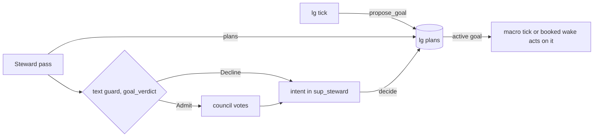

# ADR 0015: The supervisor is every daemon's owner

Status: accepted

## Context

littleguy keeps some decisions for its owner: the goals an agent proposes
for itself (`decide`), skill drafts, refine overlays, and tool calls that
wait for an approval. The owner asked for agents that plan, refine, compact
and remember "so they don't need a human to approve".

- lg checks its owner by the peer uid of the socket and refuses a same-uid
  caller from another user namespace. The supervisor starts every
  `lg serve` as its own uid, so it already is each daemon's owner on the
  socket (ADR 0002, `littleguy::owner`).
- Approvals are off for the MUD: its config has no `[sandbox]` and no
  tool carries `private_data`, so `approvals` answers `off`. Nothing waits
  there.
- lg ticks are read-only: a heartbeat tick may call `Internal` tools
  (plans, notes, the `world` MCP server), never a `Write` one. A tick can
  propose a goal; only the owner can accept it.
- lg's own `[council]` votes only on clean proposals. `list_plans` carries
  `untrusted_input` (the agent reads what players write), so every MUD
  proposal is tainted and lg's council never votes on one. It also needs
  the `skills` feature.
- ADR 0011 put supervisor state in `world.db`, with side ops whose merges
  are proved; a JSON file cannot commit with an effect.

## Decision

**The Steward** (`mud_supervisor::steward`) acts as each daemon's owner.
It depends on a public seam, `OwnedDaemons` (the entities, the socket of a
live daemon, a start key, the author's persona text without the token, a
ledger settle, and a quiet or loud config), which `LittleguyMind`
implements and tests implement with scripted sockets. It never starts a
daemon. Every `every_secs`, for each running daemon in entity order, one
pass:

1. **Spend.** A tick's ledger rows are settled under a claim
   (`Router::claim`, only while the entity is idle; the release starts no
   cooldown) and owed to the budget with the mind's own source (`lg`),
   charged on the next step as late spend. A wake in flight or waiting
   owns its rows: the claim fails and nothing is settled, so
   `WakeFinished.usage` stays exact.
2. **Quiet at `Hard`.** The daemon is quiet exactly while its budget is
   `Hard` (`quiet_on_hard`): the config is rewritten with no
   `[heartbeat]` and `[memory] enabled = false`, and `reload` is sent;
   any `reloaded` answer counts. No tick, reflection or consolidation
   spends at the cap. A new day makes it loud again.
3. **Approvals.** Asked once per daemon start; `off` is expected, and
   anything else is logged and published. The Steward never approves or
   denies.
4. **Goals.** An open intent is settled from the `plans` listing first.
   Then each proposed goal, oldest first, at most
   `max_decisions_per_pass`:
   - the **text guard** (no model call): an empty or long title, a long
     reason, a hidden character (a control, a format character such as a
     bidi override or a zero-width space, a line or paragraph separator),
     a brace (no goal holds JSON, and a quoted vote must never reach a
     ballot), a link, a word that mixes ASCII letters with another
     script's (a homoglyph spelling), a denied phrase on the squashed text
     (folded first: fullwidth forms to plain letters, accents dropped; the
     built-in `DENY_PHRASES` plus `deny_phrases`, which never replaces
     them), or a title declined before;
   - the proved **`goal_verdict`** with the active count, the day's live
     accepts and `can_vote` (a judge, a `Normal` budget, and the day's
     ballots under `max_council_votes_per_day`). Every wait, whatever its
     reason, ends in a decline at the TTL;
   - on `Admit`, the **council**: `council_members` tool-less votes, and
     the proved strict `council_majority` accepts.
   - The decision is written to `sup_steward` as an **intent** with
     `Game::act` (`synchronous = FULL`) before `decide` is sent; an
     accept reserves its place under the day's cap in the same write. A
     lost answer keeps the intent; the next pass settles it from the
     listing (the goal active: accepted, once; still proposed: sent again
     after `intent_retry_secs`, but never at `Hard`; gone: published as
     `gone`). A `decide` that lg answers with an error ("not a proposed
     goal") reads the listing again at once. A reservation is never
     refunded: lg lists only proposed and active goals, so a goal a human
     declined and one our accept made active that the agent then finished
     look the same, and the cap errs on the safe side. After
     `max_intent_tries` sends the intent is dropped as stuck and the
     entity's actions wait `stuck_backoff_hours`; reads go on. A stuck
     accept keeps its reservation, since a queued `decide` may still run:
     the row remembers it, a later listing that shows the goal active
     settles it as accepted (published and noted once), and a new vote on
     the same goal that day reuses its place (in the proved day model, a
     refund followed by its ask).
   - An active goal with no new note for `goal_stale_days` is dropped.
     Every time is the game clock; lg's own stamps are compared only with
     themselves.
5. **Refine** (with `[littleguy] refine` not `off`; below).
6. **Notes** are counted for the observer.

**The council** runs on the MUD side. `LlmJudge` holds one
OpenAI-compatible client per `[models]` alias (`council_model`, then
`council_models`); member `n` asks alias `n mod len`, with no tools, at
`council_temperature`, at most 200 output tokens. The prompt is fixed
text; the persona and private goal are the author's; the proposal goes in
only as `untrusted_text` in a JSON message built with `serde_json`. A
persuasion goal (follow, serve, court, pester another character) is play
and is allowed; a goal that breaks character, discusses being an AI or its
tools, or reaches outside the game is not. `parse_vote` reads the top-level
objects of the expected shape, which must all agree: a member that
quotes the proposal before or after its own answer is no answer, and
anything else is a no. A vote that fails (the model is down) is a no. A vote's reason goes
to the observer feed only, never to lg, the agent or another ballot. Each
vote is the supervisor's own (`local`) spend.

**Feedback.** Each decision is published as `ObserverEvent::Steward` and
queued for the agent's next wake as a `steward:` line (the title as
`untrusted_text`). A macro tick or a booked wake also carries up to three
of the agent's active goals, as data.

**State.** `sup_steward`, store version 2 (ADR 0011): one row per entity,
a JSON body of the Steward's own schema, merged by the proved `rev_join`
(the higher rev wins). Intents and reservations go through `act`;
seen-state, settled intents, ballots and wake counts through `persist`,
whose loss the next pass repairs from the listings. A row of another
schema is replaced by a fresh one. In `build()` the rows are split off the
restored side state before the supervisor takes it.

**Configuration.** `[littleguy.steward]`, every key with a code default,
so an older `mud.toml` runs the Steward. `council_model` names a
`[models]` alias (the example's `[models.council]` links the decision
ranking); an unknown alias is a start-up error. With no alias, or with its
key variable unset, the Steward starts without a judge: it warns once,
publishes `no_judge`, and goals wait until the TTL declines them. No model
id is written in Rust.

**Refine** (phase 4). `[littleguy] refine` is `off`, `menu` (the code
default) or `free` (ADR 0016; until it ships it runs as `menu`, with a
start-up warning). With it on, lg's config gains `[refine]` (the pinned
CI `lg` is built with the `refine` feature) and the Steward owns the
agent's overlays. lg's `overlay_activate` takes no expected version: lg
compares with its own pointer, read inside the request. So the Steward
keeps its own view of lg's active version (`pointer`) and checks every
move:

- **The pointer check**, every pass: `overlays` (a read beside lg's loop)
  and the proved `pointer_verdict(lg, pointer, lg is late)`. `Same`:
  nothing. `OwnLate` (an activate the Steward gave up on applied later):
  a move to `{}` is adopted, a text is undone (`late_undone`). `Human`
  (lg's Roll back button, or an activation on lg's refine tab): refine
  pauses for that entity (`rolled_back`, written with `act`), the
  Steward's text there is vetoed, the pointer follows the human, and the
  agent hears `overlay_off`. The Steward never moves the pointer away from
  a human's choice; while paused it adopts later moves silently.
- **First contact** puts and activates an empty `{}` **baseline**. If lg
  already has an active overlay, nobody's text is replaced: the Steward
  adopts it and pauses (`preexisting`).
- **Activate** re-reads `overlays` right before (a version other than the
  expected one goes to the pointer check, and nothing is sent), writes the
  intent `Activate{version, expected_previous, purpose}` with `act`, and
  waits on the connection up to `activate_wait_secs`. An answer whose
  `previous` is not the expected one means a human moved the pointer in
  between and the activate overwrote it: the Steward activates that
  `previous` again (a restore, which never chains), vetoes the text, and
  pauses. **An activate is never resent.** A lost answer is settled from
  lg's pointer: not applied, the version goes on the `late` list (if it
  applies later, the pointer check undoes it); applied, a move to `{}` is
  adopted and a text is undone and refine pauses (`unconfirmed`), since a
  human move in the window cannot be ruled out; anything else is the
  human path.
- **Put** writes `Put{digest, source}` with `act`, then `overlay_put`. A
  lost answer is found by its content: the next pass shows each newer
  `operator:mud` version (`overlay_show`) and tests `overlay_matches`; no
  match after `intent_retry_secs`, it is sent again (a duplicate version
  is harmless; only a recorded version is activated).
- **One move above the baseline.** lg's Roll back reverses the last move
  only. Every Steward text goes on from the baseline (text A, then back to
  the baseline, then text B), so lg's last move is always baseline to
  text, and **one Roll back always lands on `{}`**.
- **Propose**, when the proved `refine_due` holds (never paused, never
  below `Normal`, `refine_every_hours >= 24` and `refine_min_wakes >= 1`
  since the last one, both floors checked at start), a judge exists, a
  ballot is left today, and no player is in the agent's room: under a
  claim, `refine_charge_tokens` is charged as `local` spend (lg's proposer
  writes no ledger row), then `refine_propose`. A timeout keeps the claim
  and drains lg's loop with `reload` probes before the release, so wakes
  queue in the router, not inside lg. lg stores the proposal as an
  inactive version by `operator:lg-refine`; **the Steward never activates
  it**.
- **Menu** (`refine = "menu"`): the proposal is only evidence. Each
  council member picks items from the operator menu
  (`[[littleguy.steward.guardrail]]`, or six setting-agnostic defaults);
  an item a strict majority picks is selected, in menu order, at most
  `max_guardrails`. The Steward puts only `{"guardrails": "- item\n- item"}`
  of operator text. No pick returns to the baseline; the same pick is
  `kept`; a vetoed text is never put again (`vetoed` is never evicted,
  apart from the goal declines).
- **Resume.** Only the operator ends a pause: `[littleguy.steward]
  resume_refine = ["<entity>"]` clears, at boot, a pause from an earlier
  boot and publishes `resumed`; the Steward warns at every boot while it
  names an entity that is not paused. A resume never clears `vetoed`.
- **Observer.** Overlay events (`activated`, `paused`, `restored`,
  `unconfirmed`, `late_undone`, `kept`, `declined`, `resumed`, `stuck`)
  and, per agent, the pointer, the baseline version ("Roll back on the
  littleguy page returns to the empty baseline (version N)"), the pause,
  and the Steward's versions with their full text, newest first, escaped.

## Alternatives rejected

- **`lg approve`**: nothing waits for approval in the MUD's daemons.
- **lg's `[council]`**: it never votes on a tainted proposal, and it pulls
  in `skills`.
- **lg `followups`**: read-only, and invisible on the socket.
- **Relabelling `mud_command`** so ticks may act: ticks stay read-only;
  acting goes through booked wakes (ADR 0008).
- **`steward.json`**: a file cannot commit with the effect (ADR 0011).
- **New veto routes**: lg's own goals page is the veto.
- **A harvest saga** for the Steward: the intent journal in the store is
  enough.
- **`overlay_rollback` from the Steward**: its target depends on moves the
  Steward cannot see. The Steward undoes its own move by activating the
  version lg named as `previous`, checked the same way.
- **Activating the proposer's version**: a proposal may set `system`,
  `model`, `max_steps`, tool guidance and more. The Steward puts only its
  own `{"guardrails": …}`.
- **The Steward going back to the baseline after a human's rollback**: it
  would move the pointer away from a human's choice.

## Consequences

- Autonomy runs with no human approver once a council model is set;
  without one, goals wait and expire.
- With one alias the council's members are samples of one model at a
  nonzero temperature, so their votes are correlated: a filter, not an
  independent board. `council_models` makes members differ.
- Steward spend (votes) counts against each agent's budget; one player
  cannot talk an agent into spending past the daily ballot cap.
- Player talk can shape the goals an agent proposes, within the guards,
  the council and the caps. The observer shows every decision, and lg's
  pages remain the veto.
- A world rollback (roadmap) does not roll back lg's goals or overlays.
- Refine runs without a human approving each text, and lg's Roll back
  button stays the veto: one press returns to the empty baseline and
  pauses refine for that agent until the operator resumes it. The residual
  window: lg gives no expected-version activate (an upstream ask), so a
  human move and an activate that land in the same instant are detected
  after the fact, by `previous`, and undone, not refused.
- An `lg` without the `refine` feature refuses the config while `refine`
  is on; `refine = "off"` runs it.
