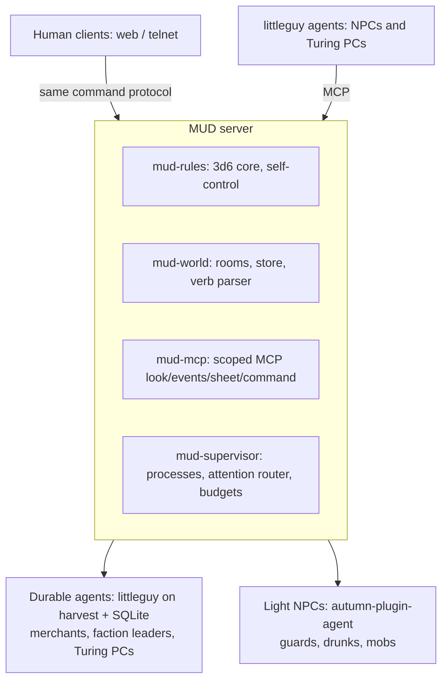

# littleguy MUD — Design Document (v0.1)

This is the design this repository implements. Where the build made a
decision the design left open, the ADRs in `docs/adr/` record it.

## 1. Core thesis and invariants

A text-native, room-based MUD where humans and littleguy agents share the
exact same world and command surface. Persistent NPCs inhabit the world
with private memory and goals, while one or two hidden agent PCs serve as
an informal Turing experiment.

**Hard invariants**

- **The server owns physics.** Rooms, exits, HP/FP, inventory, currency
  and combat resolution live in the MUD server. Neither humans nor agents
  can narrate state into existence: every state mutation goes through the
  same deterministic verb parser.
- **Information is strictly local.** No global hive mind. An agent
  observes only events in its current room (plus direct tells and boards
  it physically reads). Rumors propagate only when an entity walks to
  another room and repeats them.
- **Zero tokens in empty rooms.** Agents do not free-spin on fast ticks
  when no player is nearby. A player is any player character, a human's or
  an agent-played PC's: NPCs react to both alike, or the difference would
  give the agent PC away. Ambient world motion runs on infrequent
  macro-ticks; real-time conversation wakes are event-driven.
- **Untrusted speech is data, never instruction.** All player- and
  agent-authored text (say, emote, tell, board post) is quarantined inside
  an `untrusted_text` envelope. Server-side rules enforce permissions (a
  shopkeeper cannot give stocked merchandise without a completed sale,
  whatever the LLM asks).
- **Setting-agnostic engine.** The Rust core knows nothing about swords,
  goblins or silver. Fantasy is just the first data-driven world pack
  (`worlds/crypt-v01/`).

## 2. Topology: the Mercer pattern

The MUD server owns the world and lifecycle; littleguy owns the minds.

- **Control plane** (`mud-supervisor` → littleguy): the daemon provisions
  and supervises each persistent agent with its own SQLite database,
  generated `lg.toml` and per-entity MCP token. It owns online/offline
  schedules and pushes event-driven wakes.
- **Interaction plane** (littleguy → `mud-mcp`): from inside littleguy the
  world is a narrow MCP server. Agents do not know they are supervised,
  and any MCP-capable client can drop into a character slot.
- **The heartbeat catch.** littleguy refuses non-internal MCP calls on
  unattended heartbeat ticks, so the supervisor drives agents through the
  chat surface (room-event batches as incoming messages) and keeps
  littleguy's heartbeat for quiet reflection and memory consolidation.

## 3. Agent tiers and wake policy

| Tier | Runtime | Wake trigger | Memory |
|---|---|---|---|
| Ambient NPCs (guards, townsfolk) | autumn-plugin-agent | a human enters or speaks; 10–30 s cooldown | rolling transcript + persona card |
| Persistent inhabitants (merchants, barkeep, fence) | littleguy (harvest + SQLite) | human interaction + slow macro-tick (2–6 h) | private memory, notes, goals |
| Turing PCs (1–2 hidden accounts) | littleguy (harvest + SQLite) | room events through a selective-attention filter + session schedule | private memory, goals, grudges |

**Attention router**

| Priority | Triggers | Debounce | Behavior |
|---|---|---|---|
| Immediate | attack on the entity, a tell, a self-control nudge, speech naming it | 0–500 ms | wakes at once, bypasses AFK |
| RoomBatch | player say/emote/enter/leave/drop in the room | 2–4 s rolling | one wake per burst |
| Ambient | NPC activity while a player is present | 5–10 s + cooldown | selective attention, cooldown |
| MacroTick | timer, 2–6 h ± 20% | none | only with no player in the room |

**Anti-chatter.** Each room tracks `agent_only_turns` and
`player_present`. A player event (human or agent PC) or a macro-tick
resets the count; each NPC event with no player present increments it; at
`MAX_AGENT_ONLY_TURNS` (2) the router drops cross-agent wakes in that room
until reset.

**Budget breakers.** Soft cap (80% of the daily budget): double cooldowns,
no ambient wakes. Hard cap (100%): deterministic fallback until UTC
midnight, with canned flavor ("Torin grunts and keeps hammering.").

## 4. Turing PCs

Friction, not prose: session windows shifted by a daily offset (±20
min); a 35% selective-attention filter (100% on goal keywords); 2–6 min
distracted spells while idle in town; a typing-delay buffer
(`reaction 800..2200 + (chars/5)/(wpm/60) s × jitter 0.85..1.15`, moves
and combat 600..1400 ms; combat cancels a buffered line and re-wakes);
selfish concrete goals and a terse lowercase style; blind testing (never
announce how many are online).

## 5. Rules engine (`mud-rules`)

One mechanic, `3d6 <= effective skill + modifiers`, for combat, stealth,
lockpicking, haggling and social checks; all randomness through
`DiceRng`. ST/DX/IQ/HT (default 10); HP from ST and FP from HT; wound
states (below 1/3 HP staggered with Dodge halved; at 0 reeling with HT
rolls to stay conscious; at −HP dying). Attack → Dodge/Parry/Block
(bypassed on a critical) → `(raw − DR).max(0) × multiplier` (crushing and
burn ×1, cutting ×1.5, impaling ×2). Traits with self-control numbers
(greedy 12, cowardly 12, impatient 12) roll when a trigger reaches the
room; a failure sends a private `self_control_nudge`.

## 6. Command surface and MCP

Perception and movement: `look`, `exits`, `examine`, `move`, `inventory`,
`sheet`. Social: `say`, `emote`, `tell`, `board read|post`. Economy and
items: `take`, `drop`, `give`, `buy`, `sell`, `equip`, `use`. Action and
combat: `attack`, `defend`, `flee`, `attempt <skill> [on <target>]`.

MCP tools: `mud_look`, `mud_sheet`, `mud_events(since_seq)` (with
quarantined `untrusted_text` and private nudges) and `mud_command(cmd)`
(a deterministic resolution object or a structured `error_code` such as
`POLICY_TRADE_REQUIRED`).

## 7. Starter world: `worlds/crypt-v01/`

Town (safe; guards intervene): Notice Board and Market, Smithy, Town
Square, Rusty Flagon, Dark Alley, Fence's Backroom. Cellar and crypt
(dark, −3 without a light): Cellar Landing, Wine Vault, Rat Warren,
Flooded Cistern, Ossuary Crypt. The alley grate is locked (lockpicking −2
or the key). Giant rats in the vault and warren, a rusted lockbox in the
cistern, a skeletal warden and a dwarven iron-ore cache in the ossuary.

| Entity | Role and tier | ST/DX/IQ/HT | Key skills | Traits | Seeded goal |
|---|---|---|---|---|---|
| marta | barkeep, persistent | 10/10/12/11 | fast_talk-13, detect_lies-12, merchant-11 | gossip(12), pacifist_self_defense | track who enters the cellar; sell rumors |
| torin | blacksmith, persistent | 13/11/10/12 | smith-14, merchant-12, broadsword-11 | stubborn(12), honest(12) | out of ore; 15s a chunk; posts a bounty on macro-tick 1 |
| vich | alley fence, persistent | 9/12/12/10 | stealth-13, lockpicking-13, streetwise-13 | greedy(12), cowardly(12) | buys loot at 60%; sells the grate key for 20s |
| guard_01 (Hale) | square guard, ambient | 12/11/9/11 | spear-12, intimidate-11, observation-10 | duty(12), blunt | keep the peace; warn people off the alley |
| kestrel | hidden Turing PC | 10/12/11/11 | shortsword-13, lockpicking-12, stealth-12, merchant-10 | curious(12), impatient(12) | 40s for a lantern and jerkin; recruit a human; never split under 50/50 |

## 8. Layout and v0.1 done criteria

Crates `mud-rules`, `mud-world`, `mud-mcp`, `mud-supervisor`,
`mud-server`; the pack `worlds/crypt-v01/`.

Done when:

1. A headless smoke test passes: torin posts the ore bounty on
   macro-tick 1, kestrel reads the board, and kestrel tries to recruit a
   human entering the Rusty Flagon.
2. Humans connect through the autumn-web terminal and interact with marta,
   torin, vich, guard_01 and kestrel.
3. A private observer dashboard shows live agent goals, wake triggers,
   self-control rolls and daily token burn.
